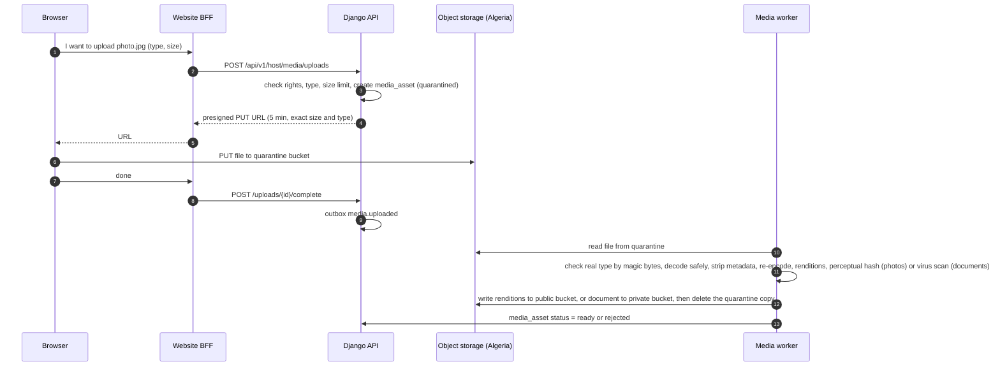
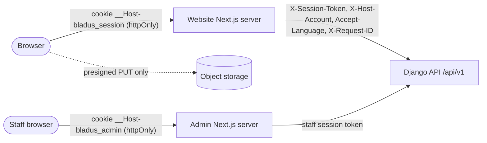

# 07. Architecture: how the Django backend is organised

> **In plain words**
> The backend is **one Django application** split into 17 small parts ("apps"), each owning its own tables and rules.
> Parts may only call parts below them, so a change in bookings can never break accounts by accident.
> Every write goes through a "service" function inside a database transaction; side effects (SMS, emails, search refresh) are queued in an "outbox" and sent after the save.
> The two Next.js apps never talk to Django from the browser: their own server keeps the login cookie and calls the API (BFF).
> We will move the apps from demo data to the real API **one module at a time**, each behind a switch, so we can always go back.
> This page also lists every background job, the caching and search plan, the photo upload pipeline, and the future repository layout.

**Terms used here** (see also [glossary.md](glossary.md)):
- **App (Django app)**: a folder inside the Django project with its own models (tables), logic and API views. Here one app = one business area ("bounded context").
- **Modular monolith**: one program, one database, deployed as one unit, but split inside into apps with strict rules about who may call whom.
- **Service**: a Python function that changes data (create a booking, approve a host). It runs the checks and the transaction.
- **Selector**: a Python function that only reads data (list my bookings). It never changes anything.
- **Transaction**: a group of database changes that all succeed together or are all cancelled together.
- **Row lock** (`SELECT ... FOR UPDATE`): while one transaction works on a row, others that want to change the same row wait.
- **Deadlock**: two transactions each wait for a row the other has locked. PostgreSQL stops one of them. A fixed lock order prevents it.
- **Outbox**: a table where a service writes "things to do after saving" in the same transaction; a worker reads it and does them.
- **Celery worker / Celery beat**: a worker runs background jobs; beat is the clock that starts scheduled jobs.
- **Queue**: a waiting line of jobs inside Redis. Different queues let slow jobs (images) not delay urgent ones (codes by SMS).
- **Cache**: a fast copy of data kept in Redis memory to avoid asking the database again.
- **Presigned URL**: a web address, valid a few minutes, that lets the browser upload or download one file directly to storage without seeing our keys.
- **BFF (backend for frontend)**: the Next.js server keeps the login cookie and calls Django for the browser.
- **Typed client**: TypeScript code generated from `openapi.yaml`, so the apps cannot call an endpoint with the wrong fields without a compile error.
- **Feature flag**: a setting that turns one part on or off without a new deployment.
- **import-linter**: a tool that fails the build if one app imports code it is not allowed to import.

Inputs: [02-research.md](02-research.md) (section B), [03-requirements.md](03-requirements.md), [04-business-rules.md](04-business-rules.md), [05-database-schema.md](05-database-schema.md) (ADR-001 to ADR-014), [schema.dbml](schema.dbml), diagrams [01-system-context](diagrams/README.md), [02-containers](diagrams/02-containers.mmd), [03-django-apps](diagrams/03-django-apps.mmd).

---

## 1. The big picture

| Layer | What runs | Where it is described |
|---|---|---|
| People | Guests, hosts, organisation members, BLADUS staff | [01-system-context](diagrams/rendered/01-system-context.svg) |
| Edge | Reverse proxy (Caddy) with TLS and coarse rate limits; CDN only for non-personal static files | [09-devops-hosting.md](09-devops-hosting.md) |
| Frontends | Website (Next.js, guests and hosts) and Admin (Next.js, staff). Each has its own server (BFF) | section 10 |
| API | Django 6.1 + DRF, one process type, modular monolith, `/api/v1/...` | sections 2 to 6 |
| Background | Celery workers (3 queues) and one Celery beat | section 6 |
| Data | PostgreSQL 17 + PostGIS, Redis, S3-compatible object storage, all in Algeria | [02-containers](diagrams/rendered/02-containers.svg) |

Decisions behind this shape are summarised as ADRs in section 12. The main ones: one Django project, not microservices (ADR-015); PostgreSQL for search at launch (ADR-020); polling for messages (ADR-021).

---

## 2. The Django apps

Seventeen domain apps plus one shared kernel (`core`). Tables are the short names used in [schema.dbml](schema.dbml); Django will prefix them with the app name (`bookings_booking`). All 77 tables have exactly one owner.

| # | App | Responsibility | Owned tables | Main rules |
|---|---|---|---|---|
| 0 | `core` (shared kernel) | Base model (UUIDv7 id, timestamps), `Money` type, error codes, idempotency, request context (user, host account, locale, request id), pagination, clock | `idempotency_record` | BR-SYS-01, BR-SYS-04, BR-SYS-05, NFR-12 |
| 1 | `geo` | Wilayas, dairas, communes; distance and map helpers; commune autocomplete | `wilaya`, `daira`, `commune` | BR-SRC-02 |
| 2 | `config` | Versioned platform settings; versioned onboarding flows per host type; feature flags (inside settings JSON) | `platform_settings`, `onboarding_flow_version` | BR-CFG-01 to 03 |
| 3 | `audit` | Hash-chained audit log; audited CSV exports; incident register with the 5-day breach clock | `audit_event`, `export_job`, `incident_record` | BR-STF-02, BR-STF-04, PRV-05 |
| 4 | `media` | Upload slots, quarantine, scanning, re-encoding, renditions, signed download URLs | `media_asset` | BR-MED-01, BR-MED-02 |
| 5 | `notifications` | Outbox table and dispatcher, in-app notifications, email and SMS providers, preferences, delivery log | `outbox_event`, `delivery_log`, `notification`, `notification_preference` | BR-SYS-03, BR-NTF-01, BR-NTF-02 |
| 6 | `accounts` | Users, sign-up and login (allauth headless), phone OTP and its send log, MFA, staff profiles, staff roles and permissions, consents, favourites, data subject requests | `user`, `staff_profile`, `staff_permission`, `staff_role_permission`, `consent_record`, `favorite`, `data_subject_request`, `otp_send_log` | BR-ACC-01 to 05, BR-STF-01, BR-PRV-01, BR-PRV-02, ACC-02 |
| 7 | `hosts` | Host accounts, organisations, memberships and roles, invitations, onboarding drafts, KYC documents, payout accounts, host verification state machine | `host_account`, `organization`, `membership`, `invitation`, `host_document`, `payout_account`, `onboarding_draft` | BR-ORG-01 to 06, BR-HST-01 to 05, BR-PAY-09 |
| 8 | `catalog` | Listings of the 5 verticals, revisions under review, vehicle and experience details, room types, photos order, amenities, categories, property types, cancellation policies, featured placements | `listing`, `listing_revision`, `vehicle_detail`, `experience_detail`, `room_type`, `listing_amenity`, `room_type_amenity`, `listing_photo`, `featured_placement`, `category`, `property_type`, `amenity`, `cancellation_policy` | BR-LST-01 to 05, BR-HST-05 |
| 9 | `inventory` | Calendar per day (homes, vehicles), per night and room type (hotels, hostels), per time slot (experiences); holds; horizon generation; iCal import and export feeds (Later) | `listing_day`, `room_type_night`, `experience_slot`, `calendar_feed` | BR-AVL-01 to 06, AVL-06 |
| 10 | `trips` | Agency trips, itinerary days, departures with seats | `trip`, `trip_itinerary_day`, `trip_departure` | BR-TRP-01 to 03 |
| 11 | `pricing` | Quotes, length-of-stay discounts, tax rates, coupons (R2) | `quote`, `tax_rate`, `coupon`, `coupon_redemption` | BR-PRC-01 to 04, BR-PRM-01, 02 |
| 12 | `ledger` | Double-entry ledger, balances, commission posting and reversal, manual top-ups, gateway webhooks (R2), dormant payments, payouts, invoices | `ledger_account`, `ledger_transaction`, `ledger_entry`, `account_balance`, `wallet_topup`, `gateway_event`, `payment`, `payout`, `invoice` | BR-PAY-01 to 12, BR-SYS-02 |
| 13 | `bookings` | Booking creation (instant and request), state machine, snapshots, cancellations, refunds owed, disputes (R2) | `booking`, `booking_event`, `refund`, `dispute` | BR-BKG-01 to 07, BR-CAN-01 to 05 |
| 14 | `reviews` | Reviews, replies, reports, rating caches | `review`, `review_reply`, `review_report` | BR-REV-01 to 04 |
| 15 | `messaging` | Conversations, participants, messages, contact masking, cursor sync | `conversation`, `conversation_participant`, `message` | BR-MSG-01 |
| 16 | `trust` | Moderation queues and cases, decisions, change requests, reason catalogue, suspension cascade, risk flags (R2) | `moderation_case`, `moderation_decision`, `change_request_item`, `reason_code` | BR-MOD-01 to 04 |
| 17 | `search` | Denormalised search table, query building, facets, map pins, trip search | `listing_search_doc` | BR-SRC-01, 03, 04 |

Count check: 1 + 3 + 2 + 3 + 1 + 4 + 8 + 7 + 13 + 4 + 3 + 4 + 9 + 4 + 3 + 3 + 4 + 1 = 77 tables (74 from Phase 5 plus `incident_record`, `calendar_feed` and `otp_send_log` added on 2026-11-09).

Differences from the Phase 4 diagram [03-django-apps](diagrams/03-django-apps.mmd): it shows 16 apps. This page adds `search` (owner of `listing_search_doc`) and the `core` kernel. `onboarding_draft` sits in `hosts` (it becomes a host account on submit), `data_subject_request` in `accounts` (it acts on the user), coupons in `pricing` (they change a quote). The diagram will be updated in the next diagram pass; the table above wins if they differ.

### 2.1 Allowed dependencies

Apps are placed in layers. **An app may import only the public functions (`services.py`, `selectors.py`) of apps in a lower layer, or of an earlier app in the same layer as listed.** Model foreign keys follow the same direction, with one exception: every app may hold a foreign key to `accounts.User` (the shared identity) and to `hosts.HostAccount`, because "who did it" and "for which host" are everywhere.

| Layer | Apps (in order) | May import from |
|---|---|---|
| L0 kernel | `core` | nothing inside the project |
| L1 platform | `geo`, `config`, `audit`, `media`, `notifications` | `core` |
| L2 identity | `accounts`, then `hosts` | L0, L1; `hosts` may import `accounts` |
| L3 offer | `catalog`, then `inventory`, then `trips` | L0 to L2; `inventory` may import `catalog`; `trips` may import `catalog` (shared policies, statuses) |
| L4 commerce | `pricing`, then `ledger`, then `bookings` | L0 to L3; `bookings` may import `pricing` and `ledger` |
| L5 after booking | `reviews`, `messaging` | L0 to L4 |
| L6 oversight and read models | `trust`, `search` | L0 to L5 |

How lower apps learn about higher events without importing them: through **outbox topics**. For example `bookings` writes `booking.confirmed`; `notifications` (L1) dispatches it to handlers that higher apps registered in their `apps.py` (`search` refreshes availability, `reviews` schedules the review window). The handler code lives in the higher app; the dispatcher only knows topic names.

The rule is checked in CI by **import-linter** with one "layers" contract and one "independence" contract per layer (for example `reviews` and `messaging` may not import each other). A violation fails the build.

### 2.2 Inside one app (services and selectors pattern)

Each app has the same files (HackSoft Django styleguide, research B.2 and B.15):

| File | Contains | Rules |
|---|---|---|
| `models.py` | Tables, `Meta.constraints`, enums | No business logic beyond `clean()` for single-field format checks |
| `services.py` | Every write: `booking_create(...)`, `host_approve(...)` | Keyword-only arguments; opens the transaction; checks permissions passed in by the API layer; raises `DomainError(code, field, params)`; writes `booking_event` / `audit_event` / `outbox_event` |
| `selectors.py` | Every read used by APIs and other apps | Always scoped by the caller (`bookings_for_guest(user)`, `bookings_for_host(host_account)`); returns querysets or plain data; no writes |
| `apis.py` | DRF views, one class per endpoint, with its input and output serializers inside | Thin: parse input, call one service or selector, serialize output. Never `Model.objects.create` here |
| `permissions.py` | django-rules predicates (`is_member_with(perm)`, `is_staff_with(perm)`) | Deny by default |
| `events.py` | Outbox topic names this app emits, handlers it registers | Handlers are idempotent |
| `tasks.py` | Celery tasks | Thin: load ids, call a service. No logic in the task itself, so moving to Django's built-in tasks later is easy (research B.5) |
| `admin.py` | Django admin console registrations | Read-mostly; any write calls a service |
| `tests/` | Factories, unit, service, API tests | See [10-testing-quality.md](10-testing-quality.md) |

Other conventions:
- **No Django signals for business logic.** Signals run hidden and cannot be rolled back with the outbox; we use explicit service calls and outbox topics (ADR-017). `pghistory` triggers are the only automatic history.
- **Errors**: services raise `DomainError("dates_unavailable")`; one DRF exception handler turns it into `{"code", "field", "message", "params"}` with HTTP status from a fixed table (BR-SYS-04).
- **Time**: services receive `now` from `core.clock` so tests can freeze it.
- **Money**: only the `core.money.Money` type crosses function boundaries; raw integers only in models.

### 2.3 API surfaces

| Prefix | Who | Authentication | Notes |
|---|---|---|---|
| `/_allauth/app/v1/...` | Everyone | allauth headless (app client, session token) | Sign-up, login, phone code, MFA, password reset |
| `/api/v1/public/...` | Anyone | none or session | Search, listing detail, trip detail, organisation profile, geography, taxonomy |
| `/api/v1/me/...` | Signed-in user | session token | Profile, favourites, my bookings (`/me/bookings`, ADR-004), conversations, notifications, privacy requests |
| `/api/v1/host/...` | Host or organisation member | session token + `X-Host-Account` header | Every request is checked: the user must hold that host account (BR-ORG-01) |
| `/api/v1/admin/...` | Staff only | staff session token with MFA done | Separate URL module and permission classes; a guest or host token never reaches it (STF-05) |
| `/api/v1/webhooks/...` | Payment gateways (R2) | signature check | Only path exposed on the public webhook host name |
| `/internal/healthz`, `/internal/readyz`, `/internal/metrics` | Monitoring | private network only | Not routed by the public proxy |

Common headers: `Accept-Language` (`en`, `fr`, `ar`), `Idempotency-Key` (required on create and money endpoints, BR-SYS-01), `X-Request-ID` (created by the BFF if missing, logged everywhere). Pagination: cursor based, page size 24 by default, maximum 50 (SRC-05). Versioning: breaking changes go to `/api/v2/` (NFR-08).

---

## 3. Transactions and locking rules

General rules:
1. `ATOMIC_REQUESTS` is **off**. Each service that writes decorates itself with `transaction.atomic()`. One service call = one transaction.
2. Isolation level stays **READ COMMITTED** (PostgreSQL default). Correctness comes from constraints, conditional updates and row locks, not from SERIALIZABLE.
3. **No network call inside a transaction** (no SMS, no storage, no gateway). Those go to the outbox or to `transaction.on_commit`.
4. Database time limits per connection: `statement_timeout = 5 s` for the API, `60 s` for workers; `lock_timeout = 2 s`; `idle_in_transaction_session_timeout = 30 s`.
5. A `@retry_on_conflict` decorator retries a whole service up to 3 times on deadlock (`40P01`) or serialization failure (`40001`), with a short random wait. Constraint violations are **not** retried; they become clean `409` errors.
6. **Global lock order** (always take locks in this order, never the reverse, to prevent deadlocks):
   1. `idempotency_record` (by key)
   2. `booking` row (state changes)
   3. inventory rows: `room_type_night` by (room type, night ascending), `experience_slot`, `trip_departure`
   4. `account_balance` row of the host wallet
   5. inserts only: `ledger_transaction`, `ledger_entry`, `booking_event`, `audit_event`, `outbox_event`

### 3.1 Creating a booking (instant or request)

One transaction, in this order (matches [20-seq-instant-booking](diagrams/rendered/20-seq-instant-booking.svg)):

| Step | What | Protects against | Rule |
|---|---|---|---|
| 1 | Insert `idempotency_record (user, endpoint, key)` with `status = in_progress`. If it exists: same body hash and completed returns the stored response; still in progress returns `409 request_in_progress`; different body returns `422 idempotency_key_reused` | Double click, network retry | BR-SYS-01 |
| 2 | Load and re-validate the quote (not expired, prices unchanged); recompute if changed and return `409 price_changed` with the new quote | Stale or tampered price | BR-PRC-01 |
| 3 | Resolve approval mode and check guest phone verified | Wrong flow | BR-BKG-01, 02, BR-ACC-01 |
| 4a | **Single unit** (home, vehicle): insert the `booking` row. The exclusion constraint refuses overlap; catch SQLSTATE `23P01` and return `409 dates_unavailable` | Double booking under concurrency | BR-AVL-01 |
| 4b | **Pool** (room type, beds, slot, departure): one conditional `UPDATE ... SET booked = booked + n WHERE ... AND held + booked + n <= total`; if updated rows differ from the number of nights (or 1 for slots and departures) the transaction is rolled back with `409 dates_unavailable` | Overselling | BR-AVL-02, BR-TRP-02 |
| 5 | If instant and confirmed: `SELECT ... FOR UPDATE` on the host wallet `account_balance`; check the credit floor; if below the floor the booking becomes `pending` instead | Two confirmations spending the same deposit | BR-PAY-10 |
| 6 | Post the commission transaction (2 entries), update the balance row | Missing or double commission (unique `(booking_id) WHERE kind = commission`) | BR-PAY-04 |
| 7 | Insert `booking_event`, `audit_event` (host money effect), `outbox_event` rows (`booking.created` or `booking.confirmed`) | Lost notifications | BR-SYS-03 |
| 8 | Mark `idempotency_record` completed with the response body | Retry returns the same booking | BR-SYS-01 |
| 9 | Commit. The deferred ledger trigger checks the balance of every transaction at this moment | Unbalanced ledger | BR-PAY-02 |

### 3.2 Changing a booking status

Accept, decline, cancel, expire, complete: `SELECT booking FOR UPDATE`, check the transition table (BR-BKG-06, table 7a in [04-business-rules.md](04-business-rules.md)), check the actor's permission (`bookings.respond` for accept and decline, DEC-009), then release or convert inventory (pool counters `booked - n`; single units are freed by the status change itself because the exclusion constraint only covers blocking statuses), post commission or reversal, insert `booking_event`, outbox. Jobs (expiry, completion) use the same service with `actor = system`, and process rows in small batches with `FOR UPDATE SKIP LOCKED` so two job runs never fight.

### 3.3 Inventory counters and holds

- Holds (`held + n`) are used only when a payment step exists (R2 and later) or for the 15-minute checkout of pooled inventory (AVL-05). A hold has an expiry; the job `inventory.release_expired_holds` turns `held - n` back, and reads ignore expired holds (BR-AVL-06).
- Host calendar edits (block a night, change a price) lock the same counter rows in the same order, so a host cannot block a night while a guest books it: one of them waits, then sees the result.
- Reducing `total` on a room type below `held + booked` is refused by the check constraint; the host sees `409 inventory_in_use` with the nights in conflict.

### 3.4 Ledger

- Only `ledger.services` writes ledger tables. Every posting function takes an **idempotency source** (`booking_id + kind`, `wallet_topup.id`, `gateway_event.id`) protected by a unique index, so a retried job never posts twice.
- The balance row is locked (`FOR UPDATE`) before any posting that can reduce it. Balance = cached sum, verified nightly against the real sum (`ledger.reconcile_balances`).
- Corrections are reversing transactions, never updates (BR-PAY-02). The app database role has no `UPDATE` or `DELETE` grant on ledger tables.
- Four-eyes top-ups (BR-PAY-07): the first finance user creates the top-up in `pending_approval`; nothing is posted until a different finance user approves. Approval and posting are one transaction.

---

## 4. Outbox

```text
service (one transaction) ──writes──> business rows + outbox_event(topic, payload, next_attempt_at=now)
                                      │
transaction.on_commit ──nudges──> Celery "outbox.dispatch" (also runs every 10 s as a safety net)
                                      │
dispatcher: SELECT ... FROM outbox_event WHERE status='pending' AND next_attempt_at <= now
            ORDER BY id LIMIT 100 FOR UPDATE SKIP LOCKED
            -> for each registered handler of the topic: run it (idempotent)
            -> success: status='sent'; failure: attempts+1, next_attempt_at = now + backoff
```

- **Backoff**: 30 s, 2 min, 10 min, 30 min, 1 h, then every hour; after 10 attempts the row becomes `failed` and an alert fires.
- **Idempotent handlers**: email and SMS handlers check `delivery_log (outbox_event_id, channel)` before sending; search refresh is naturally idempotent (it rebuilds the row).
- **Payload**: ids plus a small display snapshot (booking reference, listing title in the source language, amounts) so handlers rarely need to read other apps.
- **Retention**: sent rows deleted after 14 days; failed rows kept until a person resolves them.

Main topics: `booking.created`, `booking.confirmed`, `booking.declined`, `booking.expired`, `booking.cancelled`, `booking.completed`, `listing.published`, `listing.changed`, `listing.paused`, `host.verification_changed`, `review.published`, `wallet.below_zero`, `wallet.below_floor`, `wallet.topup_posted`, `message.created`, `media.uploaded`, `otp.requested`, `privacy.request_created`, `export.requested`.

## 5. Background jobs (Celery)

Queues: `critical` (one-time codes and booking notifications, low latency), `default` (most jobs), `media` (image work, CPU heavy, its own worker), `reports` (exports, long). Beat runs as **exactly one** container. All schedules are in Africa/Algiers time. Every task is safe to run twice (`acks_late = True`, idempotent services).

| Job | Schedule | What it does | Rule / req |
|---|---|---|---|
| `notifications.dispatch_outbox` | every 10 s + after each commit | Sends pending outbox events to their handlers | BR-SYS-03, NTF-04 |
| `notifications.send_email` / `send_sms` | on event (`critical` queue) | Renders the template in the user's language and sends via the provider interface; writes `delivery_log` | BR-NTF-02 |
| `notifications.sms_budget_check` | every 15 min | Sums SMS spend today and this month from `otp_send_log` and `delivery_log`; compares to budget; alerts at 80%; at 100% switches OTP to email or WhatsApp where possible; flags phone or IP ranges with abnormal OTP volume (pumping) | NFR-11, ACC-02, research C.2 |
| `inventory.release_expired_holds` | every 1 min | Releases holds older than 15 minutes | BR-AVL-06 |
| `inventory.extend_calendar_horizon` | daily 02:00 | Creates `room_type_night` and recurring `experience_slot` rows up to 18 months ahead | ADR-002 |
| `bookings.expire_pending_requests` | every 5 min | Pending requests past `request_expires_at` become `expired`; counters released; both sides notified | BR-BKG-04, BKG-03 |
| `bookings.complete_stays` | every 15 min | Confirmed bookings past check-out + 2 h become `completed`; review window opens; earnings counted | BR-BKG-05, BKG-04 |
| `pricing.purge_expired_quotes` | hourly | Deletes quotes expired more than 24 h ago and not linked to a booking | BR-PRC-01 |
| `reviews.recompute_ratings` | on `review.*` event + nightly 03:00 full pass | Recomputes listing, host account and organisation ratings and counts | BR-REV-04, REV-05 |
| `reviews.publish_blind_reviews` | hourly (R2) | Publishes double-blind reviews when both are in or 14 days passed | BR-REV-02 |
| `hosts.expire_invitations` | hourly | Marks invitations past 7 days as expired | BR-ORG-03 |
| `hosts.recount_host_cancellations` | daily 01:00 | Recomputes `host_cancellations_12m`; opens a moderation case at 3 | BR-CAN-03 |
| `ledger.reconcile_balances` | daily 01:30 | Checks every `account_balance` equals the sum of its entries and every transaction sums to zero; alerts on any difference | BR-PAY-02, BR-PAY-03 |
| `ledger.monthly_invoices` | 1st of month 03:00 (R2) | Builds commission invoices with gap-free numbers | BR-PAY-12 |
| `ledger.process_gateway_event` | on webhook (R2) | Verifies and applies a stored gateway event once | BR-PAY-08, BR-SYS-02 |
| `media.process_photo` | on `media.uploaded` (`media` queue) | Validates, re-encodes, strips metadata, makes renditions, computes perceptual hash | BR-MED-01 |
| `media.scan_document` | on `media.uploaded` (`media` queue) | ClamAV scan, moves the file to the private bucket or rejects it | BR-MED-02 |
| `media.purge_orphans` | daily 04:00 | Deletes quarantined or unattached uploads older than 24 h | BR-MED-01 |
| `trust.refresh_queue_priority` | every 15 min | Raises priority of cases waiting too long | BR-MOD-01 |
| `trust.evaluate_risk_rules` | on events (R2) | Runs fraud rules, opens cases, never blocks silently | BR-MOD-04 |
| `search.refresh_listing_doc` | on `listing.*`, `review.published`, `host.verification_changed` | Rebuilds the listing's search row or removes it | ADR-011, BR-SRC-01 |
| `search.rebuild_all` | weekly, Sunday 04:00 | Full rebuild and comparison, alerts on drift | ADR-011 |
| `accounts.purge_expired_sessions` | daily 02:30 | Removes expired session tokens and OTP records | BR-ACC-03 |
| `accounts.process_deletion_requests` | daily 05:00 | Anonymises users whose deletion request is due; keeps legal records | BR-PRV-02, PRV-02 |
| `accounts.retention_sweep` | daily 03:30 | Deletes ID images 90 days after decision, old messages, `otp_send_log` rows older than 90 days, old logs per the retention table | BR-PRV-05, PRV-04 |
| `audit.incident_deadline_watch` | hourly | For open `incident_record` rows with personal data involved and no `anpdp_notified_at`: alerts the owner and super admins at day 2, day 4 and 12 hours before `anpdp_deadline_at` | PRV-05 |
| `inventory.sync_calendar_feeds` | every 3 h (Later) | Fetches active iCal import feeds through the egress proxy (private IPs blocked), applies blocks, records `last_error` | AVL-06 |
| `core.purge_idempotency_records` | hourly | Deletes idempotency records older than 24 h | BR-SYS-01 |
| `audit.verify_hash_chain` | daily 00:30 | Recomputes the chain for yesterday, stores the day's last hash as an anchor, alerts on break | BR-STF-02 |
| `audit.create_next_partition` | monthly, 20th | Creates next month's partitions of `audit_event` (and `message` once partitioned) | ADR-012 |
| `audit.run_export` | on request (`reports` queue) | Builds a CSV export, formula-safe, stores it privately, audits it | BR-STF-04, STF-06 |

---

## 6. Caching strategy

Redis is used for three separate things, in separate logical databases so one cannot evict the other: **db 0** Celery broker, **db 1** cache, **db 2** rate limits, OTP counters and login locks (with `maxmemory-policy noeviction` on that instance, because losing a lock counter is a security hole).

| What | Where | Lifetime | Invalidation |
|---|---|---|---|
| Geography, taxonomy lists, experience and trip type lists | Redis + HTTP `Cache-Control: public, max-age=3600` | 24 h | Version key bumped by the service that changes them |
| Current platform settings and published onboarding flows | Redis | 60 s | Bumped on publish (BR-CFG-01, 02) |
| Public listing detail (without availability) | Redis | 5 min | Outbox `listing.changed` deletes the key |
| Search results | not cached at launch | | Measure first (NFR-02). If needed: 60 s cache on identical anonymous queries without dates |
| Facet counts for the home page | Redis | 5 min | Time only |
| Availability, prices in a booking, balances, permissions, anything personal | **never cached** | | Always read from PostgreSQL inside the transaction |

HTTP rules: personal responses send `Cache-Control: private, no-store`. Public GET responses send an `ETag`; the Next.js BFF may cache them with tagged revalidation. The CDN caches only static files and public photo renditions (see [09-devops-hosting.md](09-devops-hosting.md)), never API responses.

## 7. Search strategy

PostgreSQL only at launch (research B.7, ADR-011, ADR-020).

1. **Candidate filter** on `listing_search_doc`: vertical, wilaya or commune, guests (`capacity_guests >= n`), price range, property type, experience type, amenities (`amenity_ids @> {...}` with GIN), instant only, rating, map box (`location_public && ST_MakeEnvelope(...)` with GiST). Only published listings of approved, non-suspended host accounts have a row (BR-SRC-01).
2. **Text**: `tsv_fr`, `tsv_en`, `tsv_ar` with the right dictionary for the request language, plus trigram similarity on `search_text` (unaccented title and place names) for typos and transliteration ("Tipaza", "Tipasa", "تيبازة").
3. **Availability** (only when dates are given): for each candidate, a `NOT EXISTS` probe on the booking exclusion index (single units) or a range read on `room_type_night` (pools), plus host blocks from `listing_day`. Partial matches return the largest free sub-range (BR-AVL-05).
4. **Facets**: each facet count is computed on the filtered set without that facet's own filter (BR-SRC-01), with one `GROUP BY` per facet on the candidate set.
5. **Sort and page**: relevance, price, rating, newest; cursor pagination, 24 per page, max 50; map mode returns up to 500 pins with public points only (SRC-02, BR-SRC-03).
6. **Trips** are searched separately on `trip` + `trip_departure` (departures overlapping the dates, seats left) and shown in their own tab (ADR-004, TRP-05).
7. **Place autocomplete** uses `commune` with trigram indexes on French and Arabic names (Q15 in the schema). Free-text address lookup through Nominatim is server-side, cached, and at most 1 request per second (research C.5).

**When to add an external engine** (Meilisearch first): if search p95 stays above 500 ms with 20,000 listings after index tuning (NFR-02), or if Arabic typo tolerance is not good enough in user tests. The search table and outbox topics make this a new consumer, not a rewrite.

## 8. File upload pipeline



| Step | Photos (listing, avatar, logo) | Private documents (KYC, message attachments R2) |
|---|---|---|
| Allowed types | JPEG, PNG, WebP, HEIC | PDF, JPEG, PNG |
| Max size | 15 MB | 10 MB |
| Checks | Magic bytes, Pillow decompression-bomb limit (50 megapixels), dimensions at least 1024 px wide for listing photos | Magic bytes, ClamAV scan, PDF without JavaScript or embedded files |
| Transform | Re-encode to WebP and JPEG; renditions 320, 640, 1280, 1920 px; all metadata including GPS removed | Images re-encoded and metadata removed; PDFs stored as uploaded after a clean scan |
| Duplicates | Perceptual hash compared with other hosts' photos; a match opens a trust case (BR-MOD-04) | SHA-256 stored |
| Final bucket | `public` (served by CDN with random keys) | `private` (no public access, signed GET valid 5 minutes, every view audited) |
| Rules | BR-MED-01, MED-01, MED-03 | BR-MED-02, MED-02 |

The browser never receives storage keys, only presigned URLs. Storage keys are random UUIDs, never file names.

## 9. Internationalisation (i18n)

| Topic | Approach |
|---|---|
| Languages | `en`, `fr`, `ar`. Default `fr` (user column `preferred_locale`). Fallback order: requested, then `fr`, then `en` |
| How the API knows the language | The BFF sends `Accept-Language` from the URL locale (`/ar/...`); Django `LocaleMiddleware` activates it. Background jobs use the recipient's `preferred_locale` |
| Platform lists (amenities, categories, property types, wilayas, communes, reason codes, experience and trip types) | django-modeltranslation columns `name_en`, `name_fr`, `name_ar` (research B.9). The API returns the active language only, or all three on admin endpoints |
| Host-written text (titles, descriptions, reviews, messages) | Stored once with `source_language`; shown as written. Machine translation is a later option |
| API errors | Stable snake_case `code` (for example `dates_unavailable`) plus a translated `message`. The apps map the code to their own text (NFR-13, BR-SYS-04) |
| Notifications, emails, SMS | Django templates per language; SMS texts kept short (Arabic SMS has 70 characters per segment) |
| Numbers and dates | Latin digits in all languages (`ar-DZ` with `latn`); dates ISO 8601 in the API; display formatting is done by the apps |
| Time zone | Stored in UTC; stay dates and business days in Africa/Algiers; week starts Sunday; weekend Friday and Saturday (BR-SYS-05) |
| Translation files | `.po` files in the repository; CI fails if a message is missing in one language ([10-testing-quality.md](10-testing-quality.md) section 8) |

---

## 10. How the website and the admin will use the API

### 10.1 What exists today

Both apps are Next.js 14. All data goes through `lib/data/*` functions that read and write **in-memory mock stores** on the Next.js server (`frontend/lib/data/_store.ts`, `admin/lib/mock-data/store`). Pages and server actions call only these functions; the comments say "TODO: replace with Supabase", which this blueprint replaces with "replace with the Django API". The website signs its own session cookie (`DARNA_SESSION_SECRET`); the admin signs a JWT (`ADMIN_AUTH_SECRET`). The website has a **test mode** (`NEXT_PUBLIC_BLADUS_TEST_MODE`, ON unless set to `0`) that allows one-click demo login, a built-in secret and non-Secure cookies. **Test mode must be OFF (`0`) in every environment with real people's data**; the deploy pipeline refuses a production build where it is not `0` ([09-devops-hosting.md](09-devops-hosting.md) section 7).

### 10.2 Target: BFF



- The browser **never** holds the Django token in JavaScript. Next.js stores the allauth session token inside an encrypted, httpOnly cookie and sends it to Django in the `X-Session-Token` header from server code only (cookie flags in [08-security-privacy.md](08-security-privacy.md) section 4).
- Django is reachable from the Next.js servers over the private network. The public internet reaches only the Next.js apps and, in R2, the webhook path.
- The BFF passes the real client IP in `X-Forwarded-For`; Django trusts that header only from the BFF and proxy addresses (`TRUSTED_PROXY_IPS`), so rate limits and audit logs see the real IP.
- Client-side components that need fresh data (message polling, notifications badge) call a **Next.js route handler** that forwards to Django; they never call Django directly.

### 10.3 Typed client

- Django generates `openapi.yaml` with drf-spectacular in CI (NFR-08). It is published as a build artifact and copied into both apps (`lib/api/schema.d.ts`) by `openapi-typescript`.
- A small `server-only` wrapper `lib/api/client.ts` built on `openapi-fetch` adds the headers, timeouts (5 s), one retry for idempotent GETs, and turns API errors into the existing `ActionResult` shape. API `code` values are mapped to the apps' `ERROR_CODES` list (for example `dates_unavailable` to the website's existing date error codes); new codes are added to the `messages/*.json` files in en, fr and ar.
- Both apps run `tsc --noEmit` against the generated types in CI. An API change that breaks a call breaks the app build before deployment.

### 10.4 Migration from mock data to the API, one module at a time

Each `lib/data/<module>.ts` keeps its exported function names and return types. Inside, it chooses a source:

```text
lib/data/listings.ts           (unchanged signatures, used by pages and actions)
  ├─ lib/data/mock/listings.ts (today's code, moved)
  └─ lib/api/listings.ts       (calls Django through the typed client, maps DTOs)
switch: server-only env var BLADUS_API_MODULES="geo,taxonomy,listings"
```

The flag is a **server-only** variable (never `NEXT_PUBLIC_`), read at request time, so a module can be switched back without rebuilding. For each module: (1) build the Django endpoints and contract tests; (2) write the API adapter and a parity test (same fixture through mock and API gives the same DTO shape); (3) in staging, run in "shadow" mode for a few days (serve mock, call the API too, log differences); (4) switch staging, then production; (5) after two weeks without rollback, delete the mock code.

| Order | Website module(s) | Admin module(s) | Why this order |
|---|---|---|---|
| 1 | `geo` (via `lib/algeria.ts`), catalog type lists | `categories` | Read-only reference data, lowest risk; proves the client, headers and i18n |
| 2 | `auth` (sessions, OTP, profile) | `auth`, `team` (staff login with MFA) | Every personal module needs real users; removes the signed-cookie and JWT secrets |
| 3 | `listings`, `experiences`, `vehicles`, `trips` (read: search, detail) | `listings` (read, moderation) | Public pages; search performance can be measured |
| 4 | `organizations` + onboarding, documents | `hosts`, `approvals`, `onboarding`, `settings` | Hosts must exist and be verified before they publish |
| 5 | `listings` (write), `calendar` | `listings` (write) | Listing review flow (DEC-003) |
| 6 | `reservations`, `wallet` | `bookings`, `finance`, `ledger` | The money and availability core; needs concurrency tests green |
| 7 | `favorites`, `notifications`, `conversations` | `users`, `network` | Personal features on top of bookings |
| 8 | `reviews` | `reviews`, `audit`, `analytics`, `promotions`, `command-palette` | Need real completed bookings and audit data |

Rules during migration: a module switched to the API never writes to the mock store again; mixed states are allowed only between modules that do not share writes (for example `reservations` and `wallet` switch together because a booking posts commission).

---

## 11. Future Django repository layout

A separate repository (`bladus-api`), or a `backend/` folder in this monorepo; decided at build time. Nothing below is created in this phase.

```text
bladus-api/
├── pyproject.toml              # dependencies (uv), ruff, mypy, pytest, import-linter config
├── uv.lock
├── manage.py
├── Dockerfile                  # one image for api, workers and beat
├── compose.yaml                # dev stack (see 09-devops-hosting.md)
├── compose.prod.yaml
├── .github/workflows/          # ci.yml, contract.yml, deploy-staging.yml, deploy-prod.yml
├── openapi/
│   └── openapi.yaml            # generated, committed, diffed in CI
├── config/                     # the Django project
│   ├── settings/
│   │   ├── base.py
│   │   ├── dev.py
│   │   ├── test.py
│   │   ├── staging.py
│   │   └── production.py
│   ├── env.py                  # pydantic-settings: typed, fails fast on missing values
│   ├── urls.py                 # /api/v1/public, /me, /host, /admin, /webhooks, /_allauth
│   ├── celery.py               # queues, beat schedule (section 5)
│   ├── asgi.py
│   └── wsgi.py
├── bladus/                     # all apps live in one package
│   ├── core/                   # kernel: base model, money, errors, idempotency, clock, pagination
│   ├── geo/
│   ├── config/                 # app named "platform_config" in INSTALLED_APPS to avoid clashing with the project folder
│   ├── audit/
│   ├── media/
│   ├── notifications/
│   │   ├── providers/          # sms_local.py, sms_fallback.py, email.py (one interface)
│   │   └── templates/          # en/, fr/, ar/
│   ├── accounts/
│   ├── hosts/
│   ├── catalog/
│   ├── inventory/
│   ├── trips/
│   ├── pricing/
│   ├── ledger/
│   ├── bookings/
│   │   ├── models.py
│   │   ├── services.py
│   │   ├── selectors.py
│   │   ├── apis.py
│   │   ├── permissions.py
│   │   ├── events.py
│   │   ├── tasks.py
│   │   ├── admin.py
│   │   ├── migrations/
│   │   └── tests/
│   │       ├── factories.py
│   │       ├── test_services.py
│   │       ├── test_apis.py
│   │       ├── test_properties.py      # hypothesis
│   │       └── test_concurrency.py     # real PostgreSQL
│   ├── reviews/
│   ├── messaging/
│   ├── trust/
│   └── search/
├── locale/                     # en, fr, ar .po files
├── seeds/                      # wilayas, communes, permissions, taxonomy, settings v1 (production seeds 1 to 8)
├── tests/
│   ├── contract/               # schemathesis
│   ├── performance/            # k6 scripts
│   └── traceability/           # BR rule to test checker
├── ops/
│   ├── caddy/Caddyfile
│   ├── postgres/               # postgresql.conf, pgbackrest.conf, init SQL (extensions, roles, grants)
│   ├── prometheus/             # scrape config, alert rules
│   └── runbooks/               # copies of the runbooks in 09
└── docs/                       # links back to this blueprint
```

---

## 12. Architecture decisions (summary)

Numbering continues from [05-database-schema.md](05-database-schema.md) (ADR-001 to ADR-014).

| ADR | Decision | Rejected options | Why |
|---|---|---|---|
| ADR-015 | **Modular monolith**: one Django project, 17 apps + kernel, one database | Microservices; one big app without boundaries | Small team, one transaction for booking + inventory + ledger; Airbnb split only at hundreds of engineers (research A.1) |
| ADR-016 | **Services and selectors** (HackSoft style), thin DRF views | Logic in serializers or models ("fat models"); Django Ninja | Testable functions, one place per rule, known to Algerian Django developers (research B.2) |
| ADR-017 | **Transactional outbox** for all side effects | Django signals; calling Celery directly inside the transaction | A rolled-back change sends nothing; a crash after commit still sends (BR-SYS-03) |
| ADR-018 | **Celery + Redis** with 4 queues and one beat | Django built-in tasks (6.x), Dramatiq, Huey | Retries, schedules, monitoring today; thin tasks keep the door open to Django tasks (research B.5) |
| ADR-019 | **BFF with allauth headless session tokens** in encrypted httpOnly cookies | JWT in browser storage; SimpleJWT; Django cookies shared across domains | Tokens never reach JavaScript; revocable server-side (ACC-03); OTP, MFA and rate limits included (research B.3) |
| ADR-020 | **PostgreSQL search** (`listing_search_doc` + PostGIS + trigram) | Meilisearch, Typesense, OpenSearch at launch | One store, consistent with availability; external engine only when measured slow |
| ADR-021 | **Polling** a cursor endpoint for messages (5 to 15 s) | WebSockets via Django Channels or Centrifugo at launch | Simplest to run; Centrifugo later (research B.6) |
| ADR-022 | **S3-compatible storage hosted in Algeria**, presigned uploads, quarantine then process | Uploads through Django; Cloudinary; Cloudflare R2 for personal files | Data residency (BR-PRV-04), no large files in the API process, vendor-neutral |
| ADR-023 | **OpenAPI + openapi-typescript + openapi-fetch** typed client | Hand-written fetch calls; orval; hey-api | Small, works in server components; breaking changes fail compile (NFR-08) |
| ADR-024 | **Module-by-module migration** behind server-only flags with shadow reads | Big-bang switch; keeping mock and API both writable | Each step reversible without a rebuild; risk spread over time |
| ADR-025 | **Layered app dependencies checked by import-linter** | Convention only | Boundaries stay real as the team grows |
| ADR-026 | **READ COMMITTED + constraints + ordered row locks** | SERIALIZABLE everywhere; Redis locks | Constraints are the final guard (ADR-002); fewer retries; Redis locks are not transactional with the data |

---

## Check yourself

- [ ] Which app owns `onboarding_draft`, and why is it not in `config`?
- [ ] `notifications` is in layer L1. How can it send a "booking confirmed" email without importing `bookings`?
- [ ] Two guests book the last hotel room at the same second. Which step of section 3.1 stops the second one, and what error does it get?
- [ ] Why is no SMS ever sent from inside a database transaction?
- [ ] Which job releases inventory held for an unpaid checkout, and how often does it run?
- [ ] Which data is never cached, and why?
- [ ] What must be true before the website's `reservations` module is switched to the API, and which module switches with it?
- [ ] Where does a KYC document go after upload, and how long is a download link valid?
