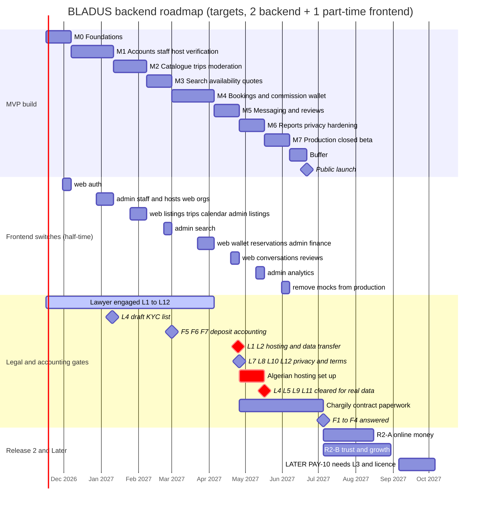

# 11. Roadmap: how we build the BLADUS backend

> **In plain words**
> This is the build plan, in eight steps (M0 to M7) up to the public launch, then Release 2 and "Later".
> Each step has a goal, the requirement IDs it delivers, a test to know it is finished, what it waits for, and a rough length in weeks.
> The two apps keep working on demo data the whole time: in each step, a few of their data files switch to the real API, one at a time, behind a switch we can turn back.
> Some steps cannot finish without an answer from a lawyer or an accountant. Those answers are shown as gates at the step that needs them.
> With 2 backend developers and 1 part-time frontend developer, the MVP takes about 29 weeks of work plus 2 weeks of buffer (about 7 months).

**Terms used here** (see [glossary.md](glossary.md)):
- **Milestone (M0 to M7)**: a block of work that ends with a check anyone can run ("exit criteria").
- **Exit criteria**: the yes/no checks that say a milestone is done.
- **Gate**: an outside answer (lawyer, accountant, bank, product owner) without which a milestone may not finish. Gate IDs (L1, F3, Q21...) come from [14-open-questions.md](14-open-questions.md) and are explained in [13-decisions-needed.md](13-decisions-needed.md).
- **`lib/data` module**: a file in the website (`frontend/lib/data/`) or admin (`admin/lib/data/`) whose functions read and write demo data today. "Switching" it means its function bodies call the API instead.
- **Feature flag (data source flag)**: a setting per module, for example `DATA_SOURCE_LISTINGS=mock|api`, read on the Next.js server. It lets us switch one module at a time and switch back in seconds if something breaks.
- **Staging**: a copy of the system with demo data only, used for testing. **Production**: the real system with real people's data.
- **Closed beta**: real hosts and guests, invited by us, before the public can sign up.
- **Gantt chart**: a bar chart of tasks over time.

Inputs: [03-requirements.md](03-requirements.md) (147 requirements), [04-business-rules.md](04-business-rules.md), [05-database-schema.md](05-database-schema.md), [01-system-inventory.md](01-system-inventory.md) section 4 (the `lib/data` bridge), [02-research.md](02-research.md) section E. The API contract is written in parallel in `06-api-design.md` and `openapi.yaml`; operations, security and testing details in `07` to `10`. The full requirement-to-milestone list is in [traceability.md](traceability.md).

---

## 1. Assumptions

| # | Assumption | If it is wrong |
|---|---|---|
| A1 | **Team: 2 backend developers full-time** (Django, PostgreSQL), **1 frontend developer half-time** (Next.js, switches the `lib/data` modules), a product owner who answers within 3 working days, and one of the backend developers acting as tech lead. | With 1 backend developer, multiply backend durations by about 1.8. |
| A2 | Work starts **Monday 2026-11-16**. Dates in the chart are targets, not promises. | Shift every date by the delay. |
| A3 | **Ramadan 2027** (about 8 February to 9 March, VERIFY the exact dates) and the two Eids lower capacity; M3 and M4 are planned a little longer for this. | Add 1 week if the team works reduced hours. |
| A4 | The 147 requirements and DEC-001 to DEC-015 do not change much. New ideas go to R2 by default (risk K-21 in [12-risks.md](12-risks.md)). | Re-plan at each milestone review. |
| A5 | Staging runs on any cloud with **demo data only**. **No real personal data exists anywhere until production is hosted in Algeria** (gates L1, L2). | Real data abroad may break Law 18-07 (VERIFY WITH A PROFESSIONAL). |
| A6 | The money model stays **M1 (prepaid commission)** for the MVP (DEC-001). Collecting guest money (M2 to M4) is a separate project behind a licence gate. | A different model adds 6 to 10 weeks and a legal track. |
| A7 | Each milestone ends with a 1-hour review: demo on staging, exit criteria checked, next milestone confirmed. | |

## 2. How the apps move from demo data to the API

1. Every `lib/data` module gets one flag (`DATA_SOURCE_<MODULE>`), default `mock`. On staging we turn modules to `api` **one at a time**, in the order of section 4.
2. The API is seeded with the **same demo cast** (Yacine, Amina, Karim, Nadia...) and the same IDs mapped to UUIDs (decision T3), so a module still on demo data can point at records that already live in the API.
3. A module is "switched" when: its functions call the typed API client (NFR-08), every page that uses it passes the frontend smoke test, and the flag has been `api` on staging for 5 working days without a rollback.
4. Once all modules of an app are switched and the launch is done, the demo store and flags are deleted (in M7 for production builds).
5. The website's `listings.ts` switches as a whole in M2 against a simple search endpoint; M3 then upgrades that same endpoint (filters, facets, availability, map) **without** a frontend change. This keeps "one module, one switch".

---

## 3. Milestones at a glance

| Milestone | Name | Weeks | Target dates | Requirements | Main gate |
|---|---|---|---|---|---|
| M0 | Foundations | 3 | 2026-11-16 to 2026-12-06 | 18 | Q22, T1 to T4, T8, T9 |
| M1 | Accounts, staff and host verification | 5 | 2026-12-07 to 2027-01-10 | 28 | L4 (draft list), T6 |
| M2 | Catalogue, trips and moderation | 4 | 2027-01-11 to 2027-02-07 | 23 | Q16, Q19, Q24, Q28 |
| M3 | Search, availability and quotes | 3 | 2027-02-08 to 2027-02-28 | 11 | T7, Q17 |
| M4 | Bookings, cancellations and the commission wallet | 5 | 2027-03-01 to 2027-04-04 | 27 | Q14, Q15, Q18, Q20, Q25, Q26, F5, F6, F7, L3 (for Q18 only) |
| M5 | Messaging and reviews | 3 | 2027-04-05 to 2027-04-25 | 8 | **L1, L2 answered** (to sign the Algerian hosting contract), T1 final |
| M6 | Reports, privacy and hardening | 3 | 2027-04-26 to 2027-05-16 | 8 | L7, L8, L10, L12, Q23 |
| M7 | Production in Algeria, closed beta, launch | 3 | 2027-05-17 to 2027-06-06 | 3 | **L1, L2, L4, L5, L9, L11 cleared** before real data; Q21, Q27 |
| Buffer | Contingency | 2 | 2027-06-07 to 2027-06-20 | | |
| **Launch** | Public launch | | target in the week of 2027-06-07, or early July after the baccalaureate exams (Q23) | | |
| R2-A | Online money: gateway, invoices, taxes | 6 | about 2027-07 to 2027-08 | 4 | **F1, F2, F3, F4** |
| R2-B | Trust and growth | 8 | about 2027-07 to 2027-09 (parallel to R2-A) | 15 | L6 (for PRV-06) |
| LATER | Behind a legal or business gate | open | not scheduled | 2 | **L3 + PSP licence** for PAY-10 |

Total MVP: **126 requirements** in M0 to M7 (109 Must, 17 Should). Counts per milestone and module: [traceability.md](traceability.md) sections 1 and 2.

---

## 4. Milestones in detail

### M0. Foundations (3 weeks)

- **Goal**: an empty but production-shaped backend: repository, CI, Django 6.1 + DRF + PostgreSQL/PostGIS + Redis + Celery (R-1), sign-up and sign-in that the website can use, the 69 wilayas, platform settings, and the shared conventions (money, time, IDs, errors, languages).
- **Scope**: ACC-01, ACC-02, ACC-03, ACC-04, ACC-07, PAY-12, SRC-04, CFG-01, PRV-01, NFR-05, NFR-06, NFR-07, NFR-08, NFR-09, NFR-10, NFR-11, NFR-12, NFR-13.
- **Exit criteria**:
  - CI runs lint, type checks, tests with coverage gate, dependency scan and OpenAPI generation on every pull request; main branch deploys to staging automatically.
  - A visitor signs up on the website (staging) with email or `+213` phone, gets a code, verifies, signs in, signs out; the session token is revoked on logout (ACC-03).
  - 69 wilayas and 1,541 communes are seeded with `source` and `valid_from` (BR-SRC-02); a test counts them.
  - `platform_settings` v1 holds the default commission rates (1,200 / 1,500 / 1,800 / 1,000 bp) and request TTL 24 h.
  - Error envelope has stable codes and en/fr/ar messages; money helper and UUIDv7 helper have property tests.
- **Dependencies**: decisions T1 (staging host only), T2, T3, T4, T8, T9; Q22 (foreign phone numbers) for ACC-01.
- **`lib/data` switches**: website `auth.ts` (sign-up, sign-in, profile read). Website `lib/algeria.ts` static wilaya list replaced by the geography endpoint (same flag pattern).
- **Gates**: none blocking. Start the lawyer engagement now (L1, L2, L4, L5, L9, L11 take months).

### M1. Accounts, staff and host verification (5 weeks)

- **Goal**: staff can sign in to the admin with 2FA and the right permissions; a user can become a host (individual or organisation), upload documents, and be verified by a moderator; organisations have teams.
- **Scope**: ACC-05, ACC-06, ACC-08, ORG-01 to ORG-07, HST-01, HST-02, HST-03, HST-04, HST-06, NTF-04, MED-02, MOD-01, MOD-02, MOD-03, MOD-08, STF-01 to STF-05, CFG-02, CFG-04.
- **Exit criteria**:
  - A staff member is invited, sets a password and TOTP, signs in; a guest session is refused on `/api/v1/admin/*` (STF-05).
  - Every staff mutation writes one `audit_event`; the app's database role cannot UPDATE or DELETE that table (test).
  - A user completes the 12-step individual flow and the 5-step agency flow served from the published config; the draft resumes on another browser.
  - Documents go to the private bucket; a moderator approves them one by one; the host is approved only when all required documents are approved (BR-HST-03).
  - Invitations can be accepted; an organisation always has exactly one owner (DB constraint test).
  - The outbox sends the invitation email through the worker with retries.
- **Dependencies**: M0; T6 (object storage); a **draft** KYC document list per host type from L4 (the list is data, so the final list can change later without code).
- **`lib/data` switches** (in this order): admin `credentials.ts`, `team.ts`, `audit.ts`, `settings.ts`, `users.ts`, `onboarding.ts`, `hosts.ts`, `approvals.ts`; website `organizations.ts`, then the onboarding part of `auth.ts` (`updateUserHostStatus`).
- **Gates**: L4 draft answer expected by the end of M1 (soft). KYC files on staging are fake files only (A5).

### M2. Catalogue, trips and moderation (4 weeks)

- **Goal**: approved hosts create listings of every vertical and agencies create trips with departures; everything goes through review before publication; photos are processed safely.
- **Scope**: ACC-09, HST-07, LST-01 to LST-08, LST-10, LST-11, LST-12, TRP-01, TRP-02, TRP-03, TRP-04, TRP-07, AVL-03, MED-01, MED-03, MOD-06, CFG-05.
- **Exit criteria**:
  - An individual host can only create home and vehicle listings; an agency only experiences and trips; a hotel only its property (API and database trigger tests, DEC-014).
  - A submitted listing is `pending_review`; it appears publicly only after approval; editing a key field returns it to review via `listing_revision`.
  - Photos are uploaded directly to quarantine, re-encoded, stripped of GPS data; a home needs 5 photos (Q19).
  - Suspending a host pauses all its listings and trips (MOD-06).
  - The demo catalogue (18 listings, 4 trips) is re-created through the API on staging.
- **Dependencies**: M1 (host accounts, moderation queues); decisions Q16 (hostel vertical), Q19 (minimum photos), Q24 (moderation staffing), Q28 (verticals at launch).
- **`lib/data` switches**: admin `categories.ts`, `listings.ts`; website `favorites.ts`, `listings.ts` (as a whole, against a basic published-only search), `vehicles.ts`, `experiences.ts`, `trips.ts`, `calendar.ts`.
- **Gates**: L5 (whole-home rental by individuals) should be answered before M7; if the answer is negative, the home vertical for individuals is switched off by setting, not by code.

### M3. Search, availability and quotes (3 weeks)

- **Goal**: guests find what is free on their dates, in Arabic, French or English, on a list or a map, and get a server-computed price.
- **Scope**: TRP-05, AVL-04, PRC-01, PRC-02, PRC-03, PRC-05, SRC-01, SRC-02, SRC-03, SRC-05, SRC-06.
- **Exit criteria**:
  - Search filters and facet counts match the mock's behaviour on the demo catalogue (the website's existing filter tests pass against the API).
  - Searching "تيزي وزو", "Tizi Ouzou" and "tizi-ouzou" returns the same top results (SRC-03, decision T7).
  - A quote lists nights, per-day prices, discount, cleaning fee, total in whole dinars, has an ID and expires after 30 minutes.
  - First performance run: search p95 measured on 20,000 generated listings (target 500 ms is enforced in M6).
- **Dependencies**: M2; T7 (Arabic search approach); Q17 (one room type per booking).
- **`lib/data` switches**: none new on the website (the `listings.ts` endpoint gets richer); admin `network.ts` and `command-palette.ts` (global search).
- **Gates**: none.

### M4. Bookings, cancellations and the commission wallet (5 weeks)

- **Goal**: the heart of the product: instant and request bookings that can never double-book, cancellations by policy, and the prepaid commission wallet on a double-entry ledger (model M1).
- **Scope**: HST-05, AVL-01, AVL-02, AVL-05, BKG-01 to BKG-10, CAN-01 to CAN-04, PAY-01, PAY-02, PAY-03, PAY-04, PAY-05, PAY-07, PAY-08, NTF-01, NTF-02.
- **Exit criteria**:
  - Concurrency test on real PostgreSQL: 50 parallel requests for the same home and nights give exactly one booking; for a 3-room hotel room type, exactly 3 (AVL-01, AVL-02).
  - Same `Idempotency-Key` twice returns the same booking (BKG-10).
  - Expiry and completion jobs run on schedule, not on read (BKG-03, BKG-04).
  - Ledger property test: every transaction sums to zero; the worked examples of [04-business-rules.md](04-business-rules.md) section 9 give the exact centimes.
  - A finance staff member records a top-up with a receipt; the same receipt is refused a second time; above the threshold a second person must approve (Q15).
  - Booking confirmed, declined, expired and cancelled each produce an in-app notification and an email or SMS in the user's language.
- **Dependencies**: M3; decisions Q14 (credit floor), Q15 (four-eyes threshold), Q18 (deposit withdrawals), Q20 (host cancellation penalty), Q25 (minimum first deposit), Q26 (reply window for agencies); accountant answers F5, F6, F7 (how deposits and commissions are recorded and receipted); bank or CCP account opened for host top-ups.
- **`lib/data` switches** (in this order): website `wallet.ts`, `reservations.ts`, `notifications.ts`; admin `ledger.ts`, `finance.ts`, `bookings.ts`.
- **Gates**: if Q18 says hosts may withdraw unused deposit, **L3** must confirm this is not a payment service before the withdrawal flow is switched on (VERIFY WITH A PROFESSIONAL). The rest of M4 does not wait.

### M5. Messaging and reviews (3 weeks)

- **Goal**: guests and hosts talk before and after booking, with contact details masked until confirmation; guests review completed stays; ratings come from real reviews.
- **Scope**: REV-01, REV-03, REV-04, REV-05, MSG-01, MSG-02, MSG-03, MSG-04.
- **Exit criteria**:
  - Messages sync by cursor; a phone number or CCP number typed before confirmation is masked for the other side (MSG-04).
  - A review is accepted only for a completed booking within 14 days, once (REV-01); listing rating changes after publication.
  - The admin can hide and restore a reported review with a reason.
- **Dependencies**: M4 (completed bookings).
- **`lib/data` switches**: website `conversations.ts`, `reviews.ts`; admin `reviews.ts`.
- **Gates**: **L1 and L2 must be answered by the end of M5** so the Algerian hosting contract (T1) can be signed and set up during M6. This is the most important date in the plan.

### M6. Reports, privacy and hardening (3 weeks)

- **Goal**: the admin can run the business (KPIs, exports), users can exercise their data rights, and the system meets its speed and safety targets.
- **Scope**: STF-06, RPT-01, RPT-03, PRV-02, PRV-04, PRV-05, NFR-01, NFR-02.
- **Exit criteria**:
  - Load test: reads p95 under 300 ms and booking create under 600 ms at 50 requests per second on one app node; search p95 under 500 ms with 20,000 listings.
  - A user downloads their data as JSON and asks for deletion; the profile is anonymised while bookings and ledger stay (BR-PRV-02).
  - Retention job deletes ID images 90 days after a decision (period confirmed by L7).
  - Breach runbook written and rehearsed once (5-day ANPDP clock), incident register exists (T5).
  - External security review (OWASP API Top 10) with no open high findings.
- **Dependencies**: M5; L7 (retention periods), L8 (terms and privacy notice texts), L10 (foreign email/SMS providers), L12 (consumer-law checks on the booking flow); Q23 (launch date).
- **`lib/data` switches**: admin `analytics.ts`; the KPIs and exports read real data. All modules of both apps are now on `api` on staging.
- **Gates**: L7, L8, L10, L12 answered. Production hosting (T1) provisioned in Algeria during this milestone.

### M7. Production in Algeria, closed beta, launch (3 weeks + 2 weeks buffer)

- **Goal**: run in production in Algeria with real data, first with invited hosts and guests, then open to the public.
- **Scope**: PRV-03, NFR-03, NFR-04 (plus the launch checklist below).
- **Exit criteria**:
  - Production and its backups run in Algerian data centres; a restore drill from the second location meets RPO 15 min and RTO 4 h.
  - Production builds of both apps have no mock store and no demo passwords (fixes the current leak).
  - Closed beta: at least 30 real hosts (mix of the four host types, Q21 wilayas) verified, at least 50 real bookings, no double booking, no ledger mismatch in the daily reconciliation.
  - Support channels and on-call rota ready (Q27); status page and uptime monitoring active.
  - Legal checklist signed by the lawyer: L1, L2, L4, L5, L9, L11 cleared (VERIFY WITH A PROFESSIONAL).
- **Dependencies**: M6; Q21 (launch wilayas), Q23 (launch date), Q27 (support).
- **`lib/data` switches**: none new; flags and demo stores are removed from production builds.
- **Gates**: **no real personal data before L1 and L2 are cleared and production is in Algeria.**

### R2-A. Online money: gateway, invoices, taxes (about 6 weeks, after launch)

- **Goal**: hosts top up online by CIB or Edahabia through Chargily; BLADUS issues monthly commission invoices; quotes show tourist tax and VAT where they apply.
- **Scope**: PRC-04, PAY-06, PAY-09, PAY-11.
- **Exit criteria**: a test-mode top-up is credited only after a verified webhook, once per event; invoice numbers have no gaps per year; tax lines match the rates in settings.
- **Dependencies**: launch; Chargily contract signed (start the paperwork during M6, lead time is long).
- **`lib/data` switches**: website `wallet.ts` gets the top-up call (same flag); admin `finance.ts` invoices, `settings.ts` tax rates.
- **Gates**: **F1** (VAT rate on commission), **F2** (taxe de séjour), **F3** (gateway contract and amount units), **F4** (invoice numbering and retention). VERIFY WITH A PROFESSIONAL.

### R2-B. Trust and growth (about 8 weeks, in parallel with R2-A)

- **Goal**: disputes, host reviews of guests, risk flags, bulk moderation, coupons, featured listings, attachments, notification preferences, onboarding field editor, departure cancellation, foreign guest fields.
- **Scope**: LST-09, TRP-06, BKG-11, REV-02, MSG-05, MSG-06, NTF-03, MOD-04, MOD-05, MOD-07, CFG-03, PRM-01, PRM-02, RPT-02, PRV-06.
- **Exit criteria**: each requirement's acceptance sentence passes on staging; no MVP regression (full test suite green).
- **Dependencies**: launch; one backend developer each for R2-A and R2-B.
- **`lib/data` switches**: admin `promotions.ts` (last mocked admin module); admin messages pages get a new `lib/data` module (none exists today).
- **Gates**: L6 (foreign guest declaration) before PRV-06.

### LATER. Behind a legal or business gate (not scheduled)

- **Scope**: PAY-10 (guest payments, escrow, host payouts: money models M2 to M4), AVL-06 (iCal sync).
- **Gate for PAY-10**: **L3** (is it a payment service under Règlement 25-02?) and either a PSP licence (160 million DA minimum capital, [02-research.md](02-research.md) C.1) or a licensed partner bank. VERIFY WITH A PROFESSIONAL. The ledger accounts already exist (BR-PAY-11); the work is mostly integration, reconciliation and payouts (estimate 8 to 12 weeks once the gate opens).
- **AVL-06**: needs a new table and SSRF-safe fetching; schedule when hosts ask for channel managers.

---

## 5. Gantt chart

The LATER bar is a placeholder only: nothing starts until the L3 gate opens.

---

## 6. Gates by milestone (summary)

| Gate | Question (short) | Blocks | Why there |
|---|---|---|---|
| Q22 | Can foreign phone numbers verify? | M0 | Sign-up rules |
| L4 (draft) | KYC documents per host type | M1 (soft), M7 (hard) | Document types are data; final list before real hosts |
| Q16, Q19, Q24, Q28 | Hostel vertical, minimum photos, moderation staffing, verticals at launch | M2 | Catalogue rules |
| Q17 | One room type per booking | M3 | Quote shape |
| Q14, Q15, Q18, Q20, Q25, Q26 | Credit floor, four-eyes threshold, deposit withdrawal, host cancel penalty, first deposit, agency reply window | M4 | Wallet and booking rules |
| F5, F6, F7 | Receipts or invoices for deposits, accounting of deposits, collection account | M4 | Before real top-ups in M7 |
| L3 (narrow) | Are deposit withdrawals a payment service? | M4 (withdrawal flow only) | Q18 |
| **L1, L2** | Hosting in Algeria, data transfer abroad | **End of M5** | Hosting contract lead time |
| L7, L8, L10, L12 | Retention, terms text, foreign providers, consumer law | M6 | Privacy jobs, consent versions |
| **L4, L5, L9, L11** | KYC, whole-home rental, agency licence for BLADUS, company formalities | **M7** | Before real hosts |
| Q21, Q23, Q27 | Launch wilayas, launch date, support | M7 | Beta and launch |
| **F1 to F4** | VAT, tourist tax, gateway contract, invoices | **R2-A** | Online money |
| L6 | Foreign guest declaration | R2-B | PRV-06 |
| **L3 + licence** | Collecting guest money | **LATER** | Models M2 to M4 |

All legal and tax gates: VERIFY WITH A PROFESSIONAL.

## 7. What can make this plan slip

The top schedule risks (full register in [12-risks.md](12-risks.md)): late legal answers (K-23), the Algerian hosting set-up (K-18), the mock-to-API switch breaking pages (K-13), the half-time frontend developer becoming the bottleneck (K-20), scope creep from R2 into the MVP (K-21), and the baccalaureate exam period around the launch (K-17). The 2-week buffer covers one of these, not all.

---

## Check yourself

- [ ] Which milestone is the first where a guest can actually book, and which two milestones must be done before it?
- [ ] Why is the end of M5 the most important legal date in the plan?
- [ ] What does "one module at a time behind a flag" mean, and how do we roll back a module that breaks?
- [ ] Why does the website's `listings.ts` switch in M2 even though full search arrives in M3?
- [ ] Which accountant answers block online top-ups, and in which milestone?
- [ ] Can staging contain real people's data? Why not?
- [ ] What has to be true before PAY-10 (guest payments and payouts) can even be scheduled?
- [ ] If you had only one backend developer, roughly how long would the MVP take?
