# BLADUS backend: compact blueprint

**What we will build, the choices, the flows, the database and the API.** Version of 2026-11-11. The complete blueprint (all research, requirements and details) stays in `dist/BLADUS-backend-blueprint.pdf`.

## 1. What we will build

BLADUS has a website (guests and hosts) and an admin app, but no real backend: data lives in memory, disappears on restart, and the two apps do not share it. We will build **one Django backend with a PostgreSQL database** that both apps call through an API.

| Topic | Decision |
|---|---|
| Products | Homes, hotels, hostels, experiences, vehicles, agency trips |
| Who publishes what | Solo host: homes and vehicles. Agency: experiences and trips. Hotel and hostel: their property with rooms and services |
| BLADUS income | Commission paid by the host: individual 12%, agency 15%, hotel 18%, hostel 10%. Guests pay no BLADUS fee |
| Payment | **No online payment in the first release.** The guest pays the host directly; the host keeps a deposit at BLADUS. Online payment comes later |
| Cancellation | The host **always recovers the full commission** when a confirmed booking is cancelled |
| Admin | **One role: admin**, with all permissions |
| Hotels | BLADUS **connects directly to the hotel's own system** to import rooms, availability, prices and services |
| Moderation | New listings and trips are checked by the admin before going live |
| Double booking | Impossible: the database itself refuses it |
| Languages | English, French, Arabic (right-to-left), Latin digits |
| Geography | 69 wilayas, 1,541 communes |
| Size | 80 tables, 264 API operations in the first release |

## 2. Technical choices, with short comparisons

| Need | We choose | Instead of | Why |
|---|---|---|---|
| Backend framework | **Django 6.1** (Python) | Node/NestJS, Laravel | The owner knows Django; admin tools, security and database support are built in |
| API layer | **Django REST Framework** | Django Ninja | Mature permissions, rate limits and documentation tools; most Django developers know it |
| Database | **PostgreSQL + PostGIS** | MySQL, MongoDB | Date ranges and exclusion rules stop double booking inside the database; real map queries |
| Sign-in | **django-allauth (headless)**, session tokens | JWT tokens with SimpleJWT | Phone codes and two-step login included; sessions can be cancelled at once |
| Session in the apps | **Next.js server keeps an httpOnly cookie** and calls Django | Token stored in the browser | The browser never holds a token that scripts could steal |
| Background jobs | **Celery + Redis** | Django tasks, Dramatiq | Schedules, retries and monitoring are proven |
| Search | **PostgreSQL** (text + map + availability) | Meilisearch, Elasticsearch | One system, always consistent with availability; add a search engine only if needed |
| Messages | **Polling "what is new since..."** | WebSockets from day one | Much simpler to run; real-time can be added later |
| Files | **S3-compatible storage hosted in Algeria**, direct uploads | Files on the app server, Cloudinary | Cheap, safe, and personal documents stay in the country |
| Money storage | **Whole centimes + double-entry ledger** | Decimal numbers, simple balance column | No rounding errors; every dinar can be explained |
| Code structure | **One project, small apps in layers** | Many microservices | Right size for a small team |
| API contract | **OpenAPI file + generated TypeScript client** | Hand-written fetch calls | The two apps cannot drift from the API |
| Hosting | **Algerian data centre** (two sites) | European cloud | Algerian e-commerce and personal data laws point to hosting in Algeria (to confirm with a lawyer) |
| Tests | **pytest + property tests + contract tests** | Manual testing | Money and date rules are checked on thousands of cases automatically |

## 3. Payment: now and later

| | First release (now) | Later |
|---|---|---|
| Guest pays | Directly to the host: cash on arrival or transfer | By CIB or Edahabia card on BLADUS, through a payment gateway |
| BLADUS is paid | From the host's deposit: commission taken at confirmation | Commission kept from the guest's payment |
| Host deposit top-up | Transfer to BLADUS (CCP or bank); the admin records it with the receipt reference | Also online by card |
| Refund to guest | Owed by the host; BLADUS shows the amount to both sides | Made by BLADUS through the gateway |
| What is needed first | Nothing more | Gateway contract and legal confirmation that BLADUS may collect guests' money |

The database and API already contain the tables and operations for online payment (`payment`, `payout`, `gateway_event`), but they stay switched off. Adding online payment later will not need a redesign.

## 4. People and roles

| Who | Where | What they can do |
|---|---|---|
| Visitor | Website | Search, view listings and trips |
| Guest | Website | Book, cancel, message hosts, save favourites, review after a stay |
| Solo host | Website, host mode | Publish homes and vehicles, manage calendar and bookings, see the deposit |
| Organisation member | Website, host mode | Works for an agency, hotel or hostel with a team role (table below) |
| **Admin** | Admin app | Everything on the staff side: verify hosts, review listings, handle bookings and reports, record deposits, settings, exports. Two-step login is required |

There is **one admin role**. Sensitive actions that need two people (a deposit top-up above 500,000 DZD) need a second admin account. The permission tables stay in the database so roles can be split later without changing the design.

Team roles inside an organisation:

| Can do | owner | admin | manager | agent | guide |
|---|---|---|---|---|---|
| Edit organisation, manage team | yes | yes (cannot delete or transfer) | | | |
| Manage listings, trips, calendar, hotel system connection | yes | yes | yes | | |
| See bookings | yes | yes | yes | yes | own departures |
| Accept or decline requests | yes | yes | yes | | |
| Cancel as host | yes | yes | | | |
| Reply to messages | yes | yes | yes | yes | yes |
| See deposit and commission | yes | yes | | | |
| Edit bank or CCP details | yes | | | | |

## 5. Hotels: connecting their own system

When a hotel or hostel becomes a host, BLADUS connects to the system the hotel already uses, so the hotel does not type everything twice and availability stays correct.

| Way to connect | What BLADUS gets | Good for | Limit |
|---|---|---|---|
| **Channel manager** (the tool hotels use to feed booking sites) | Room types, prices, availability per night; can receive BLADUS bookings | Hotels already selling on several sites | One adapter to write per channel manager |
| **Hotel management system (PMS)** API | Same, plus services (restaurant, spa, parking) | Larger hotels with a modern system | Each system has its own API and access rules |
| **iCal calendar link** | Blocked and free dates only | Small hotels and hostels | No prices, no room details |
| **CSV file import** | Rooms, prices and services once | Hotels with no connected system | Not automatic |
| **Manual entry** | Whatever the hotel types | Always available | Hotel must keep it up to date |

How it works: the hotel owner chooses the system and enters its access key; BLADUS tests it, stores the key encrypted, imports room types, prices, availability and services, then refreshes every 15 minutes. Imported fields are read-only on BLADUS while the connection is active. A booking made on BLADUS lowers BLADUS availability immediately and is sent to the hotel system when that system accepts reservations. If a sync fails, the last good data stays and the connection is flagged for the hotel and the admin. Which hotel systems are used in Algeria must be checked with the first partner hotels; the design uses one small adapter per system, so new systems can be added without touching the rest.

## 6. Main rules

**Price.** The server calculates every price: nights x price per night (with per-day prices and weekly or monthly discounts) + cleaning fee. No BLADUS fee for the guest.

**Commission.** Rate by host type x the nights total (cleaning fee excluded). Taken from the host's deposit when the booking is confirmed. **Returned in full if the booking is cancelled**, whoever cancels. If the deposit goes more than 20,000 DZD below zero, instant bookings become requests until the host tops up.

**Dates.** Check-in day is booked, check-out day is free for the next guest. Two bookings can never overlap on the same home or vehicle; rooms, beds and seats can never be oversold.

**Booking modes.** Instant (confirmed at once) or request (host answers within 24 hours, otherwise it expires automatically).

**Cancellation by the guest** (refund owed by the host on the nights total; the cleaning fee is always returned before arrival):

| Policy | Full refund | Half refund | No refund |
|---|---|---|---|
| Flexible | 1 day or more before arrival | on arrival day | |
| Moderate | 5 days or more before | 4 to 1 days before | on arrival day |
| Strict | 14 days or more before | 13 to 7 days before | 6 days or less |

**Worked example** (villa, individual host, 12%): 3 nights x 18,500 = 55,500 DZD + cleaning 4,000 = **59,500 DZD** paid by the guest to the host.

| Event | Host deposit | BLADUS commission |
|---|---|---|
| Admin records a 50,000 DZD top-up | 50,000 | 0 |
| Booking confirmed: commission 12% x 55,500 | 43,340 (-6,660) | 6,660 |
| Guest cancels 3 days before (moderate policy): host owes the guest 27,750 + 4,000 = 31,750 | **50,000 (+6,660, full commission back)** | 0 |

**Reviews.** Only after a completed stay, within 14 days, one per booking. Ratings on listings and hosts are always calculated from reviews.

**Safety.** Phone verified before the first booking; exact address shown only after confirmation; contact details masked in messages before confirmation; every admin action written in a log that cannot be edited.

## 7. Architecture

### Who uses BLADUS and what it talks to


Guests and hosts use the website; the admin uses the admin app. Both apps call one Django API, which is the only place where data is stored and rules are applied. The API sends SMS and emails, stores photos and documents, and exchanges data with hotel systems. The payment gateway is drawn with a dotted line because online payment is not part of the first release.

### What runs where


The browser reaches a reverse proxy, then the two Next.js servers. These servers keep the login cookie and call the Django API on the user's behalf, so the browser never talks to Django directly. Background workers send messages and run timed jobs (expire requests, complete stays, sync hotel systems). PostgreSQL keeps all data, Redis is used for queues and limits, and file storage keeps photos and documents. Everything that holds personal data is planned in Algerian data centres, with a copy in a second site.

### How the backend code is organised


The backend is one Django project split into small apps arranged in layers. An arrow means "may use". An app may only use apps in lower layers: for example `bookings` uses `pricing` and `ledger`, never the opposite. This keeps the code easy to change and to test. Emails, SMS and search updates are not called directly: they go through the outbox in `notifications`.


## 8. Life cycles

### Life of a booking


Each box is a status and each arrow an allowed move. A booking starts as `pending` (the host must answer within 24 hours) or directly `confirmed` (instant booking). A pending request can be accepted, declined, withdrawn by the guest, or expire by itself. A confirmed booking ends as `completed` after check-out or `cancelled`. `disputed` is for a later release. Any move not drawn is refused by the API.

### Life of a listing or a trip


A host writes a draft and submits it. The admin approves it (published), asks for changes or rejects it. Only published listings appear in search and can be booked. The host can pause or archive a listing; the admin can suspend it. Deleting is reversible by the admin.

### Verification of a host


A new host applies and sends documents. The admin approves when all required documents are approved, asks for changes, or rejects. Changing legal details sends an approved host back to review. The admin can suspend or ban a host; a suspended host's listings are paused automatically.

### Life of a review


A guest can write a review only after a completed stay, within 14 days. It becomes public when published. If someone reports it, the admin can dismiss the report, hide the review or remove it.


## 9. Flows

### Instant booking, step by step

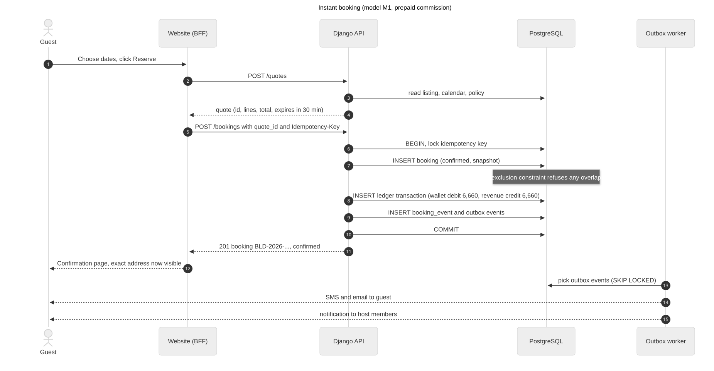

Read from top to bottom. The website first asks the API for a price (quote), then creates the booking with that quote. Everything happens in one database transaction: the booking is saved, the database itself refuses overlapping dates, the commission is taken from the host's deposit, and the messages to send are written in the outbox. After the save, a worker sends the SMS, email and notifications. The exact address is shown to the guest only after confirmation.

### Request to book

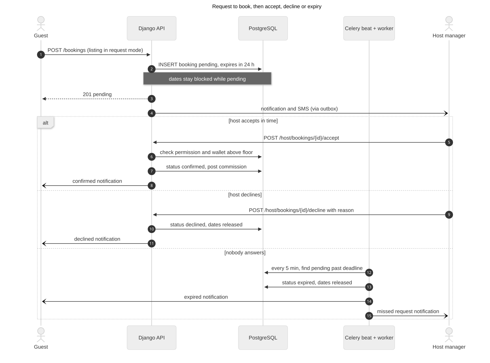

The guest sends a request and the dates are blocked while it waits. Three endings are possible: the host accepts (the booking is confirmed and the commission is taken), the host declines (dates are freed), or nobody answers and a timed job expires the request after 24 hours and tells both sides.

### Host deposit top-up

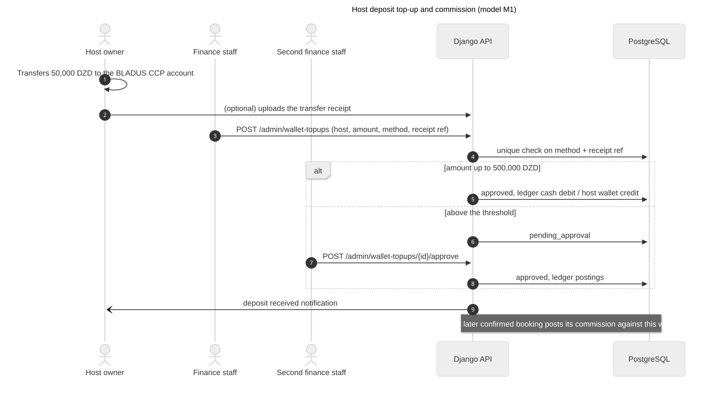

There is no online payment in the first release. The host sends money to BLADUS by CCP or bank transfer; the admin records the top-up with the receipt reference (the same receipt cannot be used twice). Large amounts need a second admin to approve. Each confirmed booking then takes its commission from this deposit, and a cancelled booking gives the full commission back.

### Becoming a host

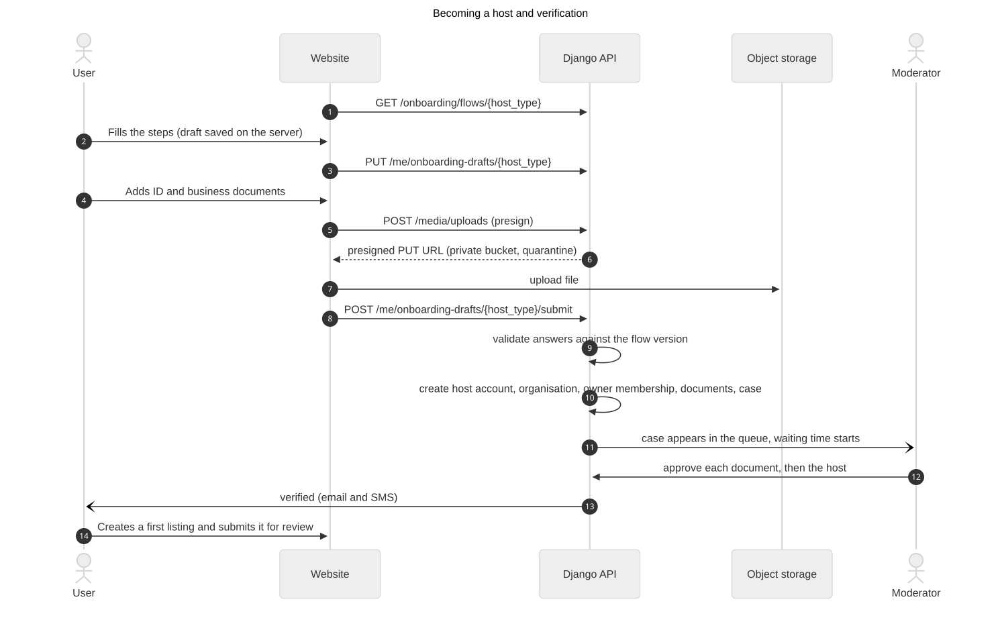

The form steps come from the published configuration, and the draft is saved on the server so the host can continue later. Documents are uploaded directly to private storage. When the host submits, a case appears in the admin queue; the admin checks each document, then approves the host, who can then create a first listing.

### Connecting a hotel's own system

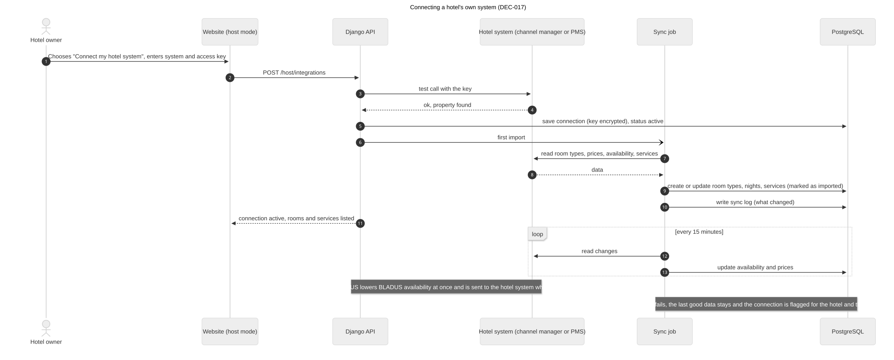

A hotel owner enters the access key of the hotel system. The API tests the connection, saves the key encrypted, and a job imports room types, prices, availability and services (restaurants, spa, parking...). The job then refreshes availability and prices every 15 minutes. If a sync fails, the last good data stays and the connection is flagged.

### Messages

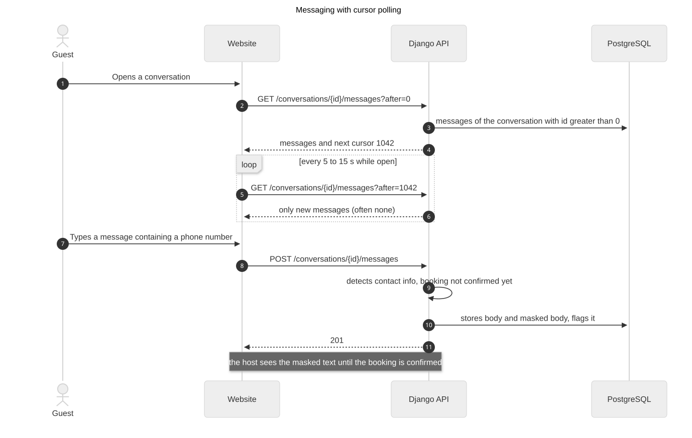

The website asks the API for messages after the last one it already has (a cursor), so repeated checks are cheap. Before a booking is confirmed, phone numbers, emails and payment account numbers written in a message are masked for the other person, to protect guests from off-platform scams.

### Where the money goes


In the first release the guest pays the host directly. The host keeps a deposit at BLADUS, topped up by transfer. BLADUS takes its commission from that deposit when a booking is confirmed and returns it in full if the booking is cancelled. Online card payment comes later.


## 10. Database

The database has **80 tables** in 14 groups. Conventions: every row has a time-ordered unique id; money is stored in whole centimes with a currency code; rates are stored in hundredths of a percent (1,200 = 12%); times are stored in UTC and stay dates in Algerian time; names of platform lists exist in English, French and Arabic; deleting is "soft" (a deleted date) wherever the admin must be able to restore.

### Relation diagram (overview)


This is the map of the central tables. Each box is a table; a line links a table to the table it points to, and the label is the linking column. Read it from `host_account` in the middle: on one side it is linked to `user` or `organization` (who hosts), on the other side it owns `listing`, `trip` and the money accounts. A `booking` points to the guest (`user`), the host account, and exactly one target: a listing, a room type, an experience slot or a trip departure. Money lines (`ledger_entry`) belong to a `ledger_transaction` and an account. The detailed diagrams below show every column.

### 1. Accounts


People and access. One `user` table for everybody; an admin is a user with a `staff_profile`. Boxes that show only `id` are tables from another group, drawn to show the link.

| Table | What it holds |
|---|---|
| `user` | Every person: guest, host, team member or admin. Email, phone, names in Latin and Arabic, language, status. |
| `staff_profile` | Marks a user as BLADUS staff. One role today: admin. |
| `staff_permission` | List of admin permissions (kept so roles can be split later). |
| `staff_role_permission` | Which role has which permission. Today: admin has all. |
| `consent_record` | History of accepted terms, privacy notice and marketing opt-in. |
| `favorite` | Listings and trips a guest saved. |

### 2. Geography


Algeria's official places. A listing points to a commune and the wilaya is deduced from it. Boxes that show only `id` are tables from another group, drawn to show the link.

| Table | What it holds |
|---|---|
| `wilaya` | The 69 wilayas with names in three languages and map shape. |
| `daira` | Dairas, between wilaya and commune. |
| `commune` | The 1,541 communes; every listing points to one. |

### 3. Host Accounts and Organisations


Who hosts. A `host_account` is either one person or one organisation; team members are linked through `membership`. Boxes that show only `id` are tables from another group, drawn to show the link.

| Table | What it holds |
|---|---|
| `host_account` | The one who hosts: either one person (solo host) or one organisation. Owns listings, trips and the deposit wallet. |
| `organization` | An agency, hotel or hostel business with its legal details. |
| `membership` | Who works in an organisation and with which role. |
| `invitation` | Invitation sent to a future team member (expires after 7 days). |
| `host_document` | Verification documents of a host (ID, commerce register, licence...), each reviewed on its own. |
| `payout_account` | The host's CCP or bank details, stored encrypted (used to return unused deposit; payouts later). |

### 4. Taxonomy


Shared lists used by listings: categories, property types, amenities, cancellation policies. Boxes that show only `id` are tables from another group, drawn to show the link.

| Table | What it holds |
|---|---|
| `category` | Categories shown on the site, per product family. |
| `property_type` | Villa, apartment, riad, SUV... per product family. |
| `amenity` | One shared list of amenities (Wi-Fi, pool, parking...). |
| `cancellation_policy` | Flexible, moderate, strict: refund percentages by days before arrival. |

### 5. Catalogue: Listings and Room Types


What is offered. A `listing` holds the common fields; vehicles and experiences have an extra detail table; hotels and hostels have room types. Boxes that show only `id` are tables from another group, drawn to show the link.

| Table | What it holds |
|---|---|
| `listing` | Something to book: home, hotel, hostel, experience or vehicle. Price, place, rules, status. |
| `listing_revision` | Edits of a published listing waiting for admin review. |
| `vehicle_detail` | Extra fields for vehicles (make, model, gearbox, driver rules). |
| `experience_detail` | Extra fields for experiences (duration, languages, meeting point). |
| `room_type` | A kind of room or bed in a hotel or hostel, with how many exist. Can be imported from the hotel system. |
| `listing_amenity` | Which amenities a listing has. |
| `room_type_amenity` | Which amenities a room type has. |
| `listing_photo` | Photos of listings, room types and trips, in order, with a cover. |
| `featured_placement` | Listings or trips the admin features on the home page for a period. |

### 6. Inventory and Calendar


What is free and at which price, per day (homes, vehicles), per night and room type (hotels, hostels) or per time slot (experiences). Boxes that show only `id` are tables from another group, drawn to show the link.

| Table | What it holds |
|---|---|
| `listing_day` | For a home or vehicle: a day the host blocked or priced differently. |
| `room_type_night` | For one room type and one night: units existing, held and booked. The database refuses overselling. |
| `experience_slot` | A dated time slot of an experience with its seats. |

### 7. Trips (agency only)


Multi-day trips sold by agencies, with a day by day programme and dated departures. Boxes that show only `id` are tables from another group, drawn to show the link.

| Table | What it holds |
|---|---|
| `trip` | A multi-day agency trip with type, price per person and policy. |
| `trip_itinerary_day` | Day by day programme of a trip. |
| `trip_departure` | A dated departure of a trip with seats and status. |

### 8. Pricing


Prices are always calculated by the server and stored as a quote. Boxes that show only `id` are tables from another group, drawn to show the link.

| Table | What it holds |
|---|---|
| `quote` | A price calculated by the server for chosen dates, valid 30 minutes. |
| `tax_rate` | Tourist tax and VAT rates with validity dates (used later). |

### 9. Bookings


Reservations and their history. A booking points to exactly one target: a listing, a room type, an experience slot or a trip departure. Boxes that show only `id` are tables from another group, drawn to show the link.

| Table | What it holds |
|---|---|
| `booking` | One reservation with frozen prices, commission and cancellation rules. The database refuses overlapping stays. |
| `booking_event` | Every status change of a booking, in order. |
| `refund` | Amounts owed back to the guest after a cancellation. |
| `dispute` | A disagreement about a stay and how it was resolved (later release). |

### 10. Money: Ledger, Wallet, Dormant Payments


Host deposits and BLADUS commission, written as balanced lines that are never edited. The payment, payout and gateway tables exist but are not used until online payment is added. Boxes that show only `id` are tables from another group, drawn to show the link.

| Table | What it holds |
|---|---|
| `ledger_account` | Money accounts: one deposit wallet per host, BLADUS cash, BLADUS commission. |
| `ledger_transaction` | One money event (top-up, commission, commission returned). Never edited. |
| `ledger_entry` | The lines of a money event; they always add up to zero. |
| `account_balance` | Current balance of each account (always equals the sum of its lines). |
| `wallet_topup` | A host deposit recorded by the admin with its receipt reference. |
| `gateway_event` | Messages from a payment gateway. Not used until online payment exists. |
| `payment` | Guest payments by card. Not used until online payment exists. |
| `payout` | Money sent to hosts. Not used until online payment exists (except returning unused deposit). |
| `invoice` | Commission invoices to hosts (later release). |

### 11. Reviews


Ratings and comments after completed stays, the host reply and reports. Boxes that show only `id` are tables from another group, drawn to show the link.

| Table | What it holds |
|---|---|
| `review` | Rating and comment after a completed booking. |
| `review_reply` | The host's single public reply to a review. |
| `review_report` | A report against a review, for the admin to check. |

### 12. Messaging and Notifications


Message threads, notifications and the reliable sending of emails and SMS. Boxes that show only `id` are tables from another group, drawn to show the link.

| Table | What it holds |
|---|---|
| `conversation` | A message thread between a guest and a host. |
| `conversation_participant` | Who is in a thread and what they have read. |
| `message` | One message; contact details are masked before a booking is confirmed. |
| `notification` | In-app notifications. |
| `notification_preference` | Which notifications a user wants by email, SMS or push. |
| `outbox_event` | Things to send after a change is saved (email, SMS, search refresh), so nothing is lost. |
| `delivery_log` | Result and cost of each email or SMS sent. |

### 13. Media


Uploaded files. Boxes that show only `id` are tables from another group, drawn to show the link.

| Table | What it holds |
|---|---|
| `media_asset` | Every uploaded file: public photos and private documents. |

### 14. Moderation, Config, Audit, Privacy, System


Admin work (queues, decisions), settings, onboarding forms, the audit log, privacy requests, hotel system connections and technical helpers. Boxes that show only `id` are tables from another group, drawn to show the link.

| Table | What it holds |
|---|---|
| `reason_code` | Preset reasons (reject, decline, cancel, report) in three languages. |
| `moderation_case` | One item in the admin queue: a host to verify, a listing to review, a report. |
| `moderation_decision` | What the admin decided on a case and why. |
| `change_request_item` | The list of changes the admin asks a host to make. |
| `platform_settings` | Platform settings by version: commission rates, reply window, switches. |
| `onboarding_flow_version` | The steps of the become-a-host forms, by host type and version. |
| `onboarding_draft` | A host application in progress, saved on the server. |
| `coupon` | Discount codes (later release). |
| `coupon_redemption` | Use of a coupon on a booking (later release). |
| `audit_event` | Who did what and when. Cannot be edited or deleted. |
| `export_job` | CSV exports requested by the admin. |
| `data_subject_request` | Requests from users to see, fix or delete their data. |
| `idempotency_record` | Protects against a request being executed twice after a retry. |
| `incident_record` | Register of security incidents with the 5-day notification clock. |
| `calendar_feed` | iCal calendar links for importing or exporting availability (later release). |
| `otp_send_log` | Log of every SMS code sent (for cost control and fraud detection). |
| `property_integration` | Connection to a hotel's own system: which system, encrypted access key, what to sync, status. |
| `integration_sync_log` | One line per sync run with what changed or why it failed. |
| `property_service` | Services of a hotel or hostel (restaurant, spa, parking...), typed by hand or imported. |
| `listing_search_doc` | One ready-to-search line per published listing; makes search fast. |


### Rules the database enforces by itself

These rules are inside PostgreSQL, so even a bug in the code cannot break them: no overlapping stays, no overselling, exactly one owner per organisation, money lines that always balance, and logs that cannot be edited.

```sql
-- Extensions
CREATE EXTENSION IF NOT EXISTS postgis;
CREATE EXTENSION IF NOT EXISTS btree_gist;   -- equality inside exclusion constraints
CREATE EXTENSION IF NOT EXISTS pg_trgm;      -- fuzzy text search
CREATE EXTENSION IF NOT EXISTS unaccent;

-- BR-AVL-01: no overlapping stays on a single unit
ALTER TABLE booking ADD CONSTRAINT booking_no_overlap
  EXCLUDE USING gist (listing_id WITH =, stay WITH &&)
  WHERE (inventory_kind = 'single'
         AND status IN ('pending','confirmed','completed','disputed'));

-- ADR-003: targets match the inventory kind
ALTER TABLE booking ADD CONSTRAINT booking_target_matches_kind CHECK (
  (inventory_kind = 'single'    AND listing_id IS NOT NULL AND room_type_id IS NULL AND experience_slot_id IS NULL AND trip_departure_id IS NULL) OR
  (inventory_kind = 'room_pool' AND listing_id IS NOT NULL AND room_type_id IS NOT NULL AND experience_slot_id IS NULL AND trip_departure_id IS NULL) OR
  (inventory_kind = 'slot'      AND listing_id IS NOT NULL AND experience_slot_id IS NOT NULL AND room_type_id IS NULL AND trip_departure_id IS NULL) OR
  (inventory_kind = 'departure' AND trip_departure_id IS NOT NULL AND listing_id IS NULL AND room_type_id IS NULL AND experience_slot_id IS NULL));

ALTER TABLE booking ADD CONSTRAINT booking_money_ok CHECK (
  subtotal_minor >= 0 AND discount_minor >= 0 AND cleaning_fee_minor >= 0 AND taxes_minor >= 0
  AND total_minor = subtotal_minor - discount_minor + cleaning_fee_minor + taxes_minor
  AND refund_due_minor BETWEEN 0 AND total_minor
  AND commission_rate_bp BETWEEN 0 AND 10000 AND commission_minor >= 0
  AND NOT isempty(stay) AND lower_inc(stay) AND NOT upper_inc(stay));

-- BR-AVL-02: pooled inventory never oversold
ALTER TABLE room_type_night ADD CONSTRAINT rtn_capacity
  CHECK (held >= 0 AND booked >= 0 AND total >= 0 AND held + booked <= total);
ALTER TABLE trip_departure ADD CONSTRAINT dep_capacity
  CHECK (seats_held >= 0 AND seats_booked >= 0 AND seats_held + seats_booked <= seats_total AND ends_on >= starts_on);
ALTER TABLE experience_slot ADD CONSTRAINT slot_capacity
  CHECK (seats_held >= 0 AND seats_booked >= 0 AND seats_held + seats_booked <= seats_total AND ends_at > starts_at);

-- Reserving 2 rooms for nights [2026-12-10, 2026-12-13): one statement, all nights or nothing
UPDATE room_type_night SET booked = booked + 2
 WHERE room_type_id = :rt AND night >= '2026-12-10' AND night < '2026-12-13'
   AND held + booked + 2 <= total;
-- the service checks that the updated row count = number of nights, else rolls back (409)

-- ADR-001: host account is exactly one of user or organisation
ALTER TABLE host_account ADD CONSTRAINT host_account_one_owner CHECK (
  (kind = 'individual'   AND user_id IS NOT NULL AND organization_id IS NULL) OR
  (kind = 'organization' AND organization_id IS NOT NULL AND user_id IS NULL));

-- BR-ORG-04: exactly one active owner
CREATE UNIQUE INDEX membership_one_owner ON membership (organization_id)
  WHERE role = 'owner' AND is_active;
CREATE UNIQUE INDEX membership_active_unique ON membership (organization_id, user_id) WHERE is_active;

-- BR-ACC-01
CREATE UNIQUE INDEX user_email_ci ON "user" (lower(email)) WHERE email IS NOT NULL;
CREATE UNIQUE INDEX user_phone ON "user" (phone_e164) WHERE phone_e164 IS NOT NULL;

-- BR-PAY-02: balanced, insert-only ledger
CREATE FUNCTION ledger_tx_balanced() RETURNS trigger AS $$
BEGIN
  IF EXISTS (SELECT 1 FROM ledger_entry WHERE transaction_id = NEW.transaction_id
             GROUP BY currency HAVING sum(amount_minor) <> 0) THEN
    RAISE EXCEPTION 'ledger transaction % is not balanced', NEW.transaction_id;
  END IF;
  RETURN NULL;
END $$ LANGUAGE plpgsql;
CREATE CONSTRAINT TRIGGER ledger_entry_balanced AFTER INSERT ON ledger_entry
  DEFERRABLE INITIALLY DEFERRED FOR EACH ROW EXECUTE FUNCTION ledger_tx_balanced();
ALTER TABLE ledger_entry ADD CONSTRAINT ledger_entry_nonzero CHECK (amount_minor <> 0);
REVOKE UPDATE, DELETE ON ledger_entry, ledger_transaction, audit_event, booking_event FROM bladus_app;

-- BR-PAY-04: commission posted once per booking
CREATE UNIQUE INDEX ledger_one_commission ON ledger_transaction (booking_id) WHERE kind = 'commission';

-- BR-LST-02, BR-CFG-02, BR-MOD: one open item at a time
CREATE UNIQUE INDEX listing_one_pending_revision ON listing_revision (listing_id) WHERE status = 'pending_review';
CREATE UNIQUE INDEX flow_one_draft ON onboarding_flow_version (host_type) WHERE status = 'draft';
CREATE UNIQUE INDEX flow_one_published ON onboarding_flow_version (host_type) WHERE status = 'published';
CREATE UNIQUE INDEX case_one_open ON moderation_case (kind, subject_id) WHERE status <> 'resolved';
CREATE UNIQUE INDEX settings_one_current ON platform_settings (is_current) WHERE is_current;
```

## 11. API design

**Conventions.** All addresses start with `/api/v1`. Data is JSON with `snake_case` names. Money is `{"amount_minor": 5950000, "currency": "DZD"}` (centimes). Dates are ISO 8601. Errors always have the same shape: a stable `code`, a message in the user's language (en, fr, ar) and field errors. Lists are paginated. Creating a booking or recording money needs an `Idempotency-Key` header, so a retry never creates a duplicate. Requests are rate limited.

**Access.** Four areas: public (no login), `me` (signed-in guest), `host` (the active workspace: the user as solo host or one of their organisations, re-checked on every call), and `admin` (staff only, two-step login). The website and admin never call Django from the browser: their Next.js server does, with the session kept in an httpOnly cookie.

**Example: create a booking**

```http
POST /api/v1/me/bookings
Idempotency-Key: 6f1c2a9e-...
{ "quote_id": "0192f3a1-..." }

201 Created
{ "reference": "BLD-2026-7K2M9Q", "status": "confirmed",
  "total": {"amount_minor": 5950000, "currency": "DZD"},
  "payment_status": "not_collected" }

409 Conflict (someone booked these dates first)
{ "code": "dates_unavailable", "message": "Ces dates ne sont plus disponibles." }
```

### Endpoint list

The contract has 272 operations; 8 of them (card payments, payouts, gateway) are switched off until online payment exists and are not listed here. The full machine-readable contract is `openapi.yaml`.

#### Sign-up and sign-in (15)

| Method | Path | What it does |
|---|---|---|
| POST | `/auth/signup` | Sign up with email or Algerian phone |
| POST | `/auth/login` | Sign in with email or phone and password |
| POST | `/auth/code/request` | Send a one-time login code by SMS (phone OTP) |
| POST | `/auth/code/confirm` | Confirm the one-time login code |
| GET | `/auth/session` | Read the current session |
| DELETE | `/auth/session` | Sign out (revoke the session token) |
| POST | `/auth/phone/verify` | Verify a phone number with the SMS code |
| POST | `/auth/email/verify` | Verify an email address with the emailed key |
| POST | `/auth/password/request` | Ask for a password reset (email link or SMS code) |
| POST | `/auth/password/reset` | Set a new password with the reset key |
| POST | `/auth/password/change` | Change password (signed in) |
| POST | `/auth/2fa/authenticate` | Second step of login: TOTP or recovery code |
| GET | `/auth/authenticators` | List my second factors |
| GET | `/auth/authenticators/totp` | Get a TOTP secret to enrol |
| POST | `/auth/authenticators/totp` | Enrol a TOTP authenticator |

#### Public (no login needed) (23)

| Method | Path | What it does |
|---|---|---|
| GET | `/geo/wilayas` | List the 69 wilayas |
| GET | `/geo/wilayas/{wilaya_code}/communes` | List the communes of one wilaya |
| GET | `/geo/communes` | Autocomplete communes by name (fr, ar, en) |
| GET | `/reference` | All shared lists (types, amenities, policies, offer rules) |
| GET | `/reference/reasons` | Reason catalogue for an action |
| GET | `/onboarding-flows/{host_type}` | Get the published onboarding flow for a host type |
| GET | `/listings` | Search listings |
| GET | `/listings/facets` | Facet counts for the current search |
| GET | `/listings/map` | Map pins for the current search (max 500) |
| GET | `/listings/{listing_id}` | Public listing page |
| GET | `/listings/{listing_id}/availability` | Free nights, units or slots for a period |
| GET | `/listings/{listing_id}/reviews` | Published reviews of a listing |
| POST | `/quotes` | Get a server price quote |
| GET | `/quotes/{quote_id}` | Read a quote again |
| GET | `/trips` | Search agency trips |
| GET | `/trips/{trip_id}` | Public trip page (path accepts the trip id or its slug) |
| GET | `/trips/{trip_id}/departures` | Upcoming departures with seats left |
| GET | `/trips/{trip_id}/reviews` | Published reviews of a trip |
| GET | `/organizations` | List verified organisations (sitemap, directory) |
| GET | `/organizations/{org_slug}` | Public organisation profile |
| GET | `/users/{user_id}` | Public user profile |
| GET | `/users/{user_id}/reviews` | Reviews written by a user or received as a host |
| GET | `/listings/{listing_id}/services` | Services of a hotel or hostel (restaurants, spa, parking...) |

#### Signed-in guest (25)

| Method | Path | What it does |
|---|---|---|
| GET | `/me` | My profile |
| PATCH | `/me` | Update my profile |
| PUT | `/me/phone` | Start a phone change (sends an SMS code) |
| GET | `/me/consents` | My current consents |
| POST | `/me/consents` | Accept or withdraw a consent (terms, privacy, marketing) |
| GET | `/me/data-requests` | My data protection requests |
| POST | `/me/data-requests` | Ask for my data, a correction or deletion |
| GET | `/me/favorites` | My favourites |
| PUT | `/me/favorites/{target_type}/{target_id}` | Add a listing or trip to favourites |
| DELETE | `/me/favorites/{target_type}/{target_id}` | Remove from favourites |
| GET | `/me/notifications` | My notifications, newest first |
| POST | `/me/notifications/{notification_id}/read` | Mark one notification as read |
| POST | `/me/notifications/read-all` | Mark all my notifications as read |
| GET | `/me/notification-preferences` | My notification preferences |
| PUT | `/me/notification-preferences` | Change my notification preferences |
| POST | `/me/bookings` | Book from a quote (instant or request) |
| GET | `/me/bookings` | My bookings (trips page) |
| GET | `/me/bookings/{booking_id}` | One of my bookings |
| GET | `/me/bookings/{booking_id}/cancellation-preview` | What I would get back if I cancel now |
| POST | `/me/bookings/{booking_id}/cancel` | Cancel my booking or withdraw my request |
| POST | `/me/bookings/{booking_id}/review` | Review a completed stay |
| POST | `/me/bookings/{booking_id}/dispute` | Open a dispute about a booking |
| GET | `/me/reviews` | Reviews I wrote |
| POST | `/reviews/{review_id}/reports` | Report a review |
| POST | `/me/invitations/accept` | Accept an organisation invitation |

#### Messages (7)

| Method | Path | What it does |
|---|---|---|
| GET | `/conversations` | My conversations |
| POST | `/conversations` | Start (or find) a conversation about a listing, trip or booking |
| GET | `/conversations/sync` | Changes since a cursor (polling) |
| GET | `/conversations/{conversation_id}` | One conversation |
| GET | `/conversations/{conversation_id}/messages` | Messages of a conversation |
| POST | `/conversations/{conversation_id}/messages` | Send a message |
| POST | `/conversations/{conversation_id}/read` | Move my read pointer |

#### File uploads (4)

| Method | Path | What it does |
|---|---|---|
| POST | `/media/uploads` | Get a presigned upload URL |
| POST | `/media/{media_id}/complete` | Tell the server the upload finished |
| GET | `/media/{media_id}` | Upload status and renditions |
| GET | `/media/{media_id}/url` | Short-lived URL for a private file |

#### Host workspace (75)

| Method | Path | What it does |
|---|---|---|
| GET | `/me/workspaces` | Host accounts I can act for (workspace switcher) |
| PUT | `/me/workspaces/active` | Switch the active host account |
| GET | `/host/account` | The active host account |
| PATCH | `/host/account` | Change the default approval mode |
| GET | `/host/onboarding/drafts` | My onboarding drafts |
| GET | `/host/onboarding/drafts/{host_type}` | My draft for one host type |
| PUT | `/host/onboarding/drafts/{host_type}` | Save my draft (create or replace) |
| DELETE | `/host/onboarding/drafts/{host_type}` | Abandon my draft |
| POST | `/host/onboarding/drafts/{host_type}/submit` | Finish onboarding: create the host account |
| GET | `/host/documents` | Verification documents of the active host account |
| POST | `/host/documents` | Attach an uploaded document |
| DELETE | `/host/documents/{document_id}` | Remove a pending or rejected document |
| POST | `/host/verification/submit` | Send the host account for review (or resubmit) |
| GET | `/host/change-requests` | What moderators asked me to fix |
| GET | `/host/payout-accounts` | Refund and payout account details |
| POST | `/host/payout-accounts` | Add a CCP, bank or BaridiMob account |
| DELETE | `/host/payout-accounts/{payout_account_id}` | Remove an account |
| GET | `/host/integrations` | Connections to the hotel's own system |
| POST | `/host/integrations` | Connect a channel manager, PMS, iCal feed or CSV import |
| DELETE | `/host/integrations/{integration_id}` | Disconnect the hotel system (imported data stays, becomes editable) |
| POST | `/host/integrations/{integration_id}/sync` | Import rooms, availability, prices and services now |
| GET | `/host/integrations/{integration_id}/runs` | History of sync runs |
| GET | `/host/organization` | The active organisation (private view) |
| PATCH | `/host/organization` | Edit the organisation |
| DELETE | `/host/organization` | Delete the organisation (soft) |
| GET | `/host/organization/members` | Team members |
| PATCH | `/host/organization/members/{membership_id}` | Change a member's role |
| DELETE | `/host/organization/members/{membership_id}` | Remove a member |
| POST | `/host/organization/transfer-ownership` | Make another member the owner |
| GET | `/host/organization/invitations` | Pending and past invitations |
| POST | `/host/organization/invitations` | Invite someone by email or phone |
| DELETE | `/host/organization/invitations/{invitation_id}` | Revoke an invitation |
| GET | `/host/listings` | Listings of the active host account (all statuses) |
| POST | `/host/listings` | Create a listing (draft) |
| GET | `/host/listings/{listing_id}` | One listing with private fields |
| PATCH | `/host/listings/{listing_id}` | Edit a listing |
| DELETE | `/host/listings/{listing_id}` | Delete a listing (soft) |
| POST | `/host/listings/{listing_id}/status` | Submit, withdraw, pause, resume or archive |
| PUT | `/host/listings/{listing_id}/photos` | Order photos and choose the cover |
| GET | `/host/listings/{listing_id}/room-types` | Room types of a hotel or hostel |
| POST | `/host/listings/{listing_id}/room-types` | Add a room type |
| PATCH | `/host/listings/{listing_id}/room-types/{room_type_id}` | Edit a room type |
| DELETE | `/host/listings/{listing_id}/room-types/{room_type_id}` | Remove a room type (soft) |
| GET | `/host/listings/{listing_id}/slots` | Time slots of an experience |
| POST | `/host/listings/{listing_id}/slots` | Add a time slot |
| PATCH | `/host/listings/{listing_id}/slots/{slot_id}` | Edit or cancel a slot |
| GET | `/host/calendar` | Calendar of several listings |
| GET | `/host/listings/{listing_id}/calendar` | Calendar of one listing or room type |
| PUT | `/host/listings/{listing_id}/calendar/blocks` | Block or unblock days |
| PUT | `/host/listings/{listing_id}/calendar/prices` | Set or clear per-day prices |
| GET | `/host/trips` | Trips of the active agency (all statuses) |
| POST | `/host/trips` | Create a trip (draft) |
| GET | `/host/trips/{trip_id}` | One trip with private fields |
| PATCH | `/host/trips/{trip_id}` | Edit a trip |
| DELETE | `/host/trips/{trip_id}` | Delete a trip (soft) |
| POST | `/host/trips/{trip_id}/status` | Submit, withdraw, pause, resume or archive a trip |
| GET | `/host/trips/{trip_id}/departures` | Departures of a trip |
| POST | `/host/trips/{trip_id}/departures` | Add a departure |
| PATCH | `/host/trips/{trip_id}/departures/{departure_id}` | Edit a departure |
| POST | `/host/trips/{trip_id}/departures/{departure_id}/cancel` | Cancel a departure and all its bookings |
| GET | `/host/bookings` | Bookings of the active host account |
| GET | `/host/bookings/{booking_id}` | One booking of the active host account |
| POST | `/host/bookings/{booking_id}/accept` | Accept a pending request |
| POST | `/host/bookings/{booking_id}/decline` | Decline a pending request |
| GET | `/host/bookings/{booking_id}/cancellation-preview` | What a host cancellation means |
| POST | `/host/bookings/{booking_id}/cancel` | Cancel a confirmed booking as host |
| POST | `/host/bookings/{booking_id}/guest-review` | Review the guest |
| POST | `/host/bookings/{booking_id}/dispute` | Open a dispute as host |
| GET | `/host/reviews` | Reviews received by the active host account |
| PUT | `/host/reviews/{review_id}/reply` | Write or edit the public reply |
| GET | `/host/wallet` | Commission wallet of the active host account |
| GET | `/host/wallet/entries` | Wallet history |
| POST | `/host/wallet/topups` | Top up the wallet online (CIB, Edahabia) |
| GET | `/host/earnings` | Earnings dashboard |
| GET | `/host/invoices` | Commission invoices |

#### Admin (115)

| Method | Path | What it does |
|---|---|---|
| POST | `/admin/auth/login` | Staff sign in (step 1: password) |
| POST | `/admin/auth/2fa/authenticate` | Staff sign in (step 2: second factor) |
| GET | `/admin/auth/session` | Current staff session and permissions |
| DELETE | `/admin/auth/session` | Staff sign out |
| POST | `/admin/auth/invitations/accept` | Accept a staff invitation and set a password |
| POST | `/admin/auth/authenticators/totp` | Enrol TOTP (required before any admin endpoint) |
| POST | `/admin/auth/password/change` | Change my staff password |
| GET | `/admin/moderation/counts` | Queue sizes, oldest waiting, high priority |
| GET | `/admin/dashboard/attention` | Dashboard: what needs attention now |
| GET | `/admin/moderation/cases` | Moderation queue |
| GET | `/admin/moderation/cases/{case_id}` | One case with its history |
| POST | `/admin/moderation/cases/{case_id}/assign` | Take or assign a case |
| POST | `/admin/moderation/cases/{case_id}/decisions` | Decide a case (approve, reject, request changes...) |
| POST | `/admin/moderation/bulk-decisions` | Same decision on many cases |
| GET | `/admin/reason-codes` | Reason catalogue (all actions) |
| GET | `/admin/hosts` | Host accounts (individuals and organisations) |
| GET | `/admin/hosts/{host_account_id}` | One host account with documents, team and cases |
| DELETE | `/admin/hosts/{host_account_id}` | Soft-delete a host account |
| POST | `/admin/hosts/{host_account_id}/approve` | Approve a host account |
| POST | `/admin/hosts/{host_account_id}/request-changes` | Ask the host for changes |
| POST | `/admin/hosts/{host_account_id}/reject` | Reject a host account |
| POST | `/admin/hosts/{host_account_id}/suspend` | Suspend a host account (cascade) |
| POST | `/admin/hosts/{host_account_id}/unsuspend` | Lift a suspension |
| POST | `/admin/hosts/{host_account_id}/ban` | Ban a host account (final) |
| POST | `/admin/hosts/{host_account_id}/restore` | Restore a soft-deleted host account |
| PUT | `/admin/hosts/{host_account_id}/commission-override` | Set a commission rate for this host |
| DELETE | `/admin/hosts/{host_account_id}/commission-override` | Go back to the host-type default rate |
| PUT | `/admin/hosts/{host_account_id}/credit-limit-override` | Set the credit floor for this host |
| GET | `/admin/documents/{document_id}/url` | View a KYC document (signed URL, audited) |
| POST | `/admin/documents/{document_id}/approve` | Approve one document |
| POST | `/admin/documents/{document_id}/reject` | Reject one document |
| GET | `/admin/listings` | All listings, every status, with facets |
| GET | `/admin/listings/{listing_id}` | One listing (with pending revision and cases) |
| DELETE | `/admin/listings/{listing_id}` | Soft-delete a listing |
| POST | `/admin/listings/{listing_id}/approve` | Approve and publish (or approve the pending revision) |
| POST | `/admin/listings/{listing_id}/reject` | Reject a listing |
| POST | `/admin/listings/{listing_id}/request-changes` | Ask the host for changes |
| POST | `/admin/listings/{listing_id}/suspend` | Suspend a published listing |
| POST | `/admin/listings/{listing_id}/restore` | Restore a soft-deleted listing to its previous status |
| POST | `/admin/listings/{listing_id}/status` | Any other allowed status change |
| PUT | `/admin/listings/{listing_id}/featured` | Feature or unfeature a listing |
| GET | `/admin/trips` | All trips, every status |
| GET | `/admin/trips/{trip_id}` | One trip |
| POST | `/admin/trips/{trip_id}/status` | Approve, reject, suspend, restore a trip |
| GET | `/admin/bookings` | All bookings with facets |
| GET | `/admin/bookings/{booking_id}` | One booking with its event history |
| POST | `/admin/bookings/{booking_id}/cancel` | Cancel a booking as staff |
| POST | `/admin/bookings/{booking_id}/refunds` | Record a full or partial refund |
| POST | `/admin/bookings/{booking_id}/dispute/resolve` | Resolve a dispute |
| GET | `/admin/refunds` | All refunds |
| GET | `/admin/users` | Users (guests and hosts as people) |
| GET | `/admin/users/{user_id}` | One user |
| DELETE | `/admin/users/{user_id}` | Soft-delete a user (anonymisation follows) |
| POST | `/admin/users/{user_id}/suspend` | Suspend a user |
| POST | `/admin/users/{user_id}/unsuspend` | Lift a user suspension |
| POST | `/admin/users/{user_id}/ban` | Ban a user |
| POST | `/admin/users/{user_id}/restore` | Restore a soft-deleted user |
| GET | `/admin/data-requests` | Data protection requests with deadlines |
| POST | `/admin/data-requests/{data_request_id}/complete` | Close a data protection request |
| GET | `/admin/reviews` | Reviews with reports |
| POST | `/admin/reviews/{review_id}/hide` | Hide a review |
| POST | `/admin/reviews/{review_id}/restore` | Publish a hidden or flagged review again |
| POST | `/admin/reviews/{review_id}/dismiss-reports` | Dismiss open reports and keep the review |
| DELETE | `/admin/reviews/{review_id}` | Remove a review (status removed) |
| GET | `/admin/finance/summary` | Finance overview |
| GET | `/admin/wallets` | Host wallets |
| GET | `/admin/wallets/{host_account_id}` | One host wallet |
| GET | `/admin/ledger/transactions` | Ledger transactions with their entries |
| POST | `/admin/ledger/adjustments` | Correct a wallet with an adjustment transaction |
| POST | `/admin/wallets/{host_account_id}/topups` | Record a manual wallet top-up |
| GET | `/admin/topups` | Top-ups (e.g. waiting for a second approval) |
| POST | `/admin/topups/{topup_id}/approve` | Second approval of a large top-up (four-eyes) |
| POST | `/admin/topups/{topup_id}/reject` | Reject a pending top-up |
| GET | `/admin/commission-rates` | Default commission rates per host type |
| PUT | `/admin/commission-rates` | Change default commission rates |
| GET | `/admin/invoices` | Commission invoices |
| GET | `/admin/settings` | Current platform settings |
| PATCH | `/admin/settings` | Change settings (creates a new version) |
| GET | `/admin/settings/versions` | Settings history |
| GET | `/admin/onboarding-flows` | Onboarding flows per host type |
| GET | `/admin/onboarding-flows/{host_type}/versions` | All versions of one flow |
| GET | `/admin/onboarding-flows/{host_type}/versions/{version}` | One version (published versions never change) |
| PUT | `/admin/onboarding-flows/{host_type}/draft` | Save the draft flow |
| POST | `/admin/onboarding-flows/{host_type}/publish` | Publish the draft as the next version |
| POST | `/admin/onboarding-flows/{host_type}/versions/{version}/republish` | Roll back: republish an older version |
| GET | `/admin/categories` | List categories |
| POST | `/admin/categories` | Create one of the categories |
| PATCH | `/admin/categories/{category_id}` | Edit, reorder, activate or deactivate one of the categories |
| DELETE | `/admin/categories/{category_id}` | Delete one of the categories if never used |
| GET | `/admin/amenities` | List amenities |
| POST | `/admin/amenities` | Create one of the amenities |
| PATCH | `/admin/amenities/{amenity_id}` | Edit, reorder, activate or deactivate one of the amenities |
| DELETE | `/admin/amenities/{amenity_id}` | Delete one of the amenities if never used |
| GET | `/admin/property-types` | List property types |
| POST | `/admin/property-types` | Create one of the property types |
| PATCH | `/admin/property-types/{property_type_id}` | Edit, reorder, activate or deactivate one of the property types |
| DELETE | `/admin/property-types/{property_type_id}` | Delete one of the property types if never used |
| GET | `/admin/coupons` | Coupons |
| POST | `/admin/coupons` | Create a coupon |
| PATCH | `/admin/coupons/{coupon_id}` | Edit, enable or disable a coupon |
| DELETE | `/admin/coupons/{coupon_id}` | Delete an unused coupon |
| GET | `/admin/staff` | Staff members |
| GET | `/admin/staff/roles` | Roles and their permissions |
| POST | `/admin/staff/invitations` | Invite a staff member |
| PATCH | `/admin/staff/{staff_id}` | Change a staff role |
| POST | `/admin/staff/{staff_id}/deactivate` | Deactivate (revokes sessions at once) |
| POST | `/admin/staff/{staff_id}/activate` | Reactivate a staff member |
| POST | `/admin/staff/{staff_id}/reset-mfa` | Reset a lost second factor |
| GET | `/admin/audit-events` | Audit log |
| POST | `/admin/exports` | Export a filtered dataset as CSV |
| GET | `/admin/exports` | My recent exports |
| GET | `/admin/exports/{export_id}` | Export status and download link |
| GET | `/admin/analytics/kpis` | KPIs with the previous period |
| GET | `/admin/analytics/charts` | Chart series |
| GET | `/admin/search` | Command palette search |


## 12. Build plan

Assumed team: 2 backend developers and 1 part-time frontend developer. The apps switch from demo data to the API one module at a time.

| Step | What is delivered | Weeks |
|---|---|---|
| M0 Foundations | Project, automatic checks, sign-up and sign-in with phone codes, wilayas and communes, settings | 3 |
| M1 Accounts and hosts | Profiles, organisations and teams, become-a-host forms, documents, admin sign-in, host verification | 5 |
| M2 Catalogue | Listings, room types, hotel system connection, trips and departures, experience and trip types, admin review | 4 |
| M3 Search | Search with filters and map, availability, prices | 3 |
| M4 Bookings and deposit | Instant and request bookings, cancellations, host deposit, commission, admin top-ups | 5 |
| M5 Messages and reviews | Conversations, notifications, reviews | 3 |
| M6 Hardening | Reports, exports, privacy requests, security and load tests | 3 |
| M7 Launch | Production hosting in Algeria, closed test with real hosts, public launch | 3 |
| Later | Online payment by card, invoices, coupons, disputes, calendar links | after launch |

Before real customers use the platform, a lawyer must confirm two points: hosting in Algeria with a `.com.dz` name, and the rules for personal data.

## Appendix: database SQL

The tables as PostgreSQL statements, generated from the schema (`schema.dbml`). Column comments are left out to keep this short; they are in the data dictionary of the full blueprint. The special rules of section 10 are added on top of these statements.

<div class="sql">

```sql
-- Generated from schema.dbml with @dbml/cli (dbml2sql --postgres). Documentation artifact, not a migration.
-- Exclusion constraints, partial indexes and triggers are in 05-database-schema.md section 6.
-- SQL dump generated using DBML (dbml.dbdiagram.io)
-- Database: PostgreSQL
-- Generated at: 2026-11-11T10:47:04.909Z

CREATE TYPE "user_status" AS ENUM (
  'active',
  'suspended',
  'banned',
  'deleted'
);

CREATE TYPE "staff_role_code" AS ENUM (
  'admin'
);

CREATE TYPE "staff_status" AS ENUM (
  'invited',
  'active',
  'deactivated'
);

CREATE TYPE "host_account_kind" AS ENUM (
  'individual',
  'organization'
);

CREATE TYPE "business_category" AS ENUM (
  'agency',
  'hotel',
  'hostel'
);

CREATE TYPE "verification_status" AS ENUM (
  'applied',
  'under_review',
  'changes_requested',
  'approved',
  'rejected',
  'suspended',
  'banned'
);

CREATE TYPE "membership_role" AS ENUM (
  'owner',
  'admin',
  'manager',
  'agent',
  'guide'
);

CREATE TYPE "invitation_status" AS ENUM (
  'pending',
  'accepted',
  'revoked',
  'expired'
);

CREATE TYPE "document_type" AS ENUM (
  'national_id',
  'passport',
  'property_proof',
  'lease_authorisation',
  'apc_declaration',
  'insurance',
  'auto_entrepreneur_card',
  'commercial_register',
  'tax_card_nif',
  'statistics_nis',
  'tourism_licence',
  'hotel_classification',
  'operating_authorisation',
  'vehicle_registration',
  'vehicle_insurance',
  'technical_inspection',
  'driving_licence'
);

CREATE TYPE "document_status" AS ENUM (
  'pending',
  'approved',
  'rejected',
  'expired'
);

CREATE TYPE "approval_mode" AS ENUM (
  'instant',
  'request'
);

CREATE TYPE "vertical" AS ENUM (
  'home',
  'hotel',
  'hostel',
  'experience',
  'vehicle'
);

CREATE TYPE "experience_type" AS ENUM (
  'excursion',
  'guided_tour',
  'nature_adventure',
  'desert',
  'sport',
  'culture_workshop',
  'gastronomy',
  'wellness'
);

CREATE TYPE "trip_type" AS ENUM (
  'group_tour',
  'private_trip',
  'adventure',
  'desert_expedition',
  'cultural',
  'hiking',
  'relaxation',
  'religious'
);

CREATE TYPE "listing_status" AS ENUM (
  'draft',
  'pending_review',
  'changes_requested',
  'published',
  'paused',
  'rejected',
  'suspended',
  'archived',
  'deleted'
);

CREATE TYPE "booking_unit" AS ENUM (
  'room',
  'bed'
);

CREATE TYPE "inventory_kind" AS ENUM (
  'single',
  'room_pool',
  'slot',
  'departure'
);

CREATE TYPE "booking_status" AS ENUM (
  'awaiting_payment',
  'pending',
  'confirmed',
  'declined',
  'expired',
  'cancelled',
  'completed',
  'disputed'
);

CREATE TYPE "payment_status" AS ENUM (
  'not_collected',
  'awaiting',
  'paid',
  'partially_refunded',
  'refunded',
  'failed'
);

CREATE TYPE "actor_role" AS ENUM (
  'guest',
  'host',
  'staff',
  'system'
);

CREATE TYPE "departure_status" AS ENUM (
  'scheduled',
  'guaranteed',
  'cancelled',
  'completed'
);

CREATE TYPE "ledger_account_kind" AS ENUM (
  'host_wallet',
  'platform_cash',
  'commission_revenue',
  'vat_payable',
  'guest_receivable',
  'escrow',
  'host_payable',
  'payout_clearing',
  'adjustments'
);

CREATE TYPE "ledger_tx_kind" AS ENUM (
  'wallet_topup',
  'commission',
  'commission_reversal',
  'adjustment',
  'guest_payment',
  'refund',
  'payout'
);

CREATE TYPE "topup_method" AS ENUM (
  'ccp_transfer',
  'bank_transfer',
  'baridimob',
  'cash_office',
  'gateway'
);

CREATE TYPE "topup_status" AS ENUM (
  'pending_approval',
  'approved',
  'rejected'
);

CREATE TYPE "review_status" AS ENUM (
  'submitted',
  'published',
  'flagged',
  'hidden',
  'removed'
);

CREATE TYPE "conversation_kind" AS ENUM (
  'inquiry',
  'booking',
  'support'
);

CREATE TYPE "media_status" AS ENUM (
  'quarantined',
  'ready',
  'rejected',
  'deleted'
);

CREATE TYPE "media_bucket" AS ENUM (
  'public',
  'private'
);

CREATE TYPE "case_kind" AS ENUM (
  'host_verification',
  'listing_review',
  'listing_revision',
  'trip_review',
  'document',
  'review_report',
  'dispute',
  'risk_flag',
  'legal_change',
  'host_cancellations'
);

CREATE TYPE "case_status" AS ENUM (
  'open',
  'in_progress',
  'resolved'
);

CREATE TYPE "case_priority" AS ENUM (
  'low',
  'normal',
  'high'
);

CREATE TYPE "flow_status" AS ENUM (
  'draft',
  'published',
  'archived'
);

CREATE TYPE "outbox_status" AS ENUM (
  'pending',
  'sent',
  'failed'
);

CREATE TYPE "dsr_kind" AS ENUM (
  'access',
  'rectification',
  'deletion',
  'opposition'
);

CREATE TABLE "user" (
  "id" uuid PRIMARY KEY,
  "email" varchar(254),
  "email_verified_at" timestamptz,
  "phone_e164" varchar(16),
  "phone_verified_at" timestamptz,
  "password" varchar(255),
  "first_name_latin" varchar(80),
  "last_name_latin" varchar(80),
  "full_name_ar" varchar(160),
  "avatar_media_id" uuid,
  "bio" text,
  "spoken_languages" varchar(2)[],
  "home_commune_id" int,
  "address_line" varchar(255),
  "preferred_locale" varchar(2) NOT NULL DEFAULT 'fr',
  "nationality_iso2" char(2),
  "status" user_status NOT NULL DEFAULT 'active',
  "is_staff" boolean NOT NULL DEFAULT false,
  "date_joined" timestamptz NOT NULL,
  "last_login_at" timestamptz,
  "deleted_at" timestamptz,
  "anonymised_at" timestamptz
);

CREATE TABLE "staff_profile" (
  "user_id" uuid PRIMARY KEY,
  "role" staff_role_code NOT NULL,
  "status" staff_status NOT NULL DEFAULT 'invited',
  "invited_by_id" uuid,
  "invited_at" timestamptz,
  "activated_at" timestamptz,
  "deactivated_at" timestamptz
);

CREATE TABLE "staff_permission" (
  "code" varchar(64) PRIMARY KEY,
  "description" text
);

CREATE TABLE "staff_role_permission" (
  "role" staff_role_code,
  "permission_code" varchar(64),
  PRIMARY KEY ("role", "permission_code")
);

CREATE TABLE "consent_record" (
  "id" uuid PRIMARY KEY,
  "user_id" uuid NOT NULL,
  "document" varchar(32) NOT NULL,
  "version" varchar(32) NOT NULL,
  "accepted" boolean NOT NULL,
  "ip" inet,
  "user_agent" text,
  "created_at" timestamptz NOT NULL
);

CREATE TABLE "favorite" (
  "id" uuid PRIMARY KEY,
  "user_id" uuid NOT NULL,
  "listing_id" uuid,
  "trip_id" uuid,
  "created_at" timestamptz NOT NULL
);

CREATE TABLE "wilaya" (
  "code" smallint PRIMARY KEY,
  "name_fr" varchar(80) NOT NULL,
  "name_ar" varchar(80) NOT NULL,
  "name_en" varchar(80) NOT NULL,
  "legacy_code_58" smallint,
  "region" varchar(16),
  "boundary" "geometry(MultiPolygon,4326)",
  "centroid" "geography(Point,4326)",
  "source" varchar(64) NOT NULL,
  "valid_from" date NOT NULL
);

CREATE TABLE "daira" (
  "id" int PRIMARY KEY,
  "wilaya_code" smallint NOT NULL,
  "name_fr" varchar(80) NOT NULL,
  "name_ar" varchar(80) NOT NULL
);

CREATE TABLE "commune" (
  "id" int PRIMARY KEY,
  "wilaya_code" smallint NOT NULL,
  "daira_id" int,
  "name_fr" varchar(100) NOT NULL,
  "name_ar" varchar(100) NOT NULL,
  "name_en" varchar(100) NOT NULL,
  "postal_code" varchar(5),
  "centroid" "geography(Point,4326)",
  "source" varchar(64) NOT NULL,
  "valid_from" date NOT NULL
);

CREATE TABLE "host_account" (
  "id" uuid PRIMARY KEY,
  "kind" host_account_kind NOT NULL,
  "user_id" uuid UNIQUE,
  "organization_id" uuid UNIQUE,
  "verification_status" verification_status NOT NULL DEFAULT 'applied',
  "status_before_delete" verification_status,
  "default_approval_mode" approval_mode NOT NULL DEFAULT 'request',
  "commission_rate_override_bp" int,
  "credit_limit_override_minor" bigint,
  "host_cancellations_12m" int NOT NULL DEFAULT 0,
  "rating_avg" numeric(3,2),
  "review_count" int NOT NULL DEFAULT 0,
  "submitted_at" timestamptz,
  "approved_at" timestamptz,
  "created_at" timestamptz NOT NULL,
  "updated_at" timestamptz NOT NULL,
  "deleted_at" timestamptz
);

CREATE TABLE "organization" (
  "id" uuid PRIMARY KEY,
  "business_category" business_category NOT NULL,
  "display_name" varchar(120) NOT NULL,
  "legal_name" varchar(160),
  "slug" varchar(140) UNIQUE NOT NULL,
  "description" text,
  "source_language" varchar(2) NOT NULL DEFAULT 'fr',
  "logo_media_id" uuid,
  "cover_media_id" uuid,
  "business_email" varchar(254),
  "business_phone_e164" varchar(16),
  "commune_id" int,
  "address_line" varchar(255),
  "rc_number" varchar(32),
  "nif" varchar(20),
  "nis" varchar(20),
  "article_imposition" varchar(20),
  "tourism_licence_number" varchar(40),
  "star_rating" smallint,
  "check_in_time" time,
  "check_out_time" time,
  "policies" jsonb,
  "team_size_range" varchar(16),
  "created_by_id" uuid NOT NULL,
  "created_at" timestamptz NOT NULL,
  "updated_at" timestamptz NOT NULL,
  "deleted_at" timestamptz
);

CREATE TABLE "membership" (
  "id" uuid PRIMARY KEY,
  "organization_id" uuid NOT NULL,
  "user_id" uuid NOT NULL,
  "role" membership_role NOT NULL,
  "is_active" boolean NOT NULL DEFAULT true,
  "joined_at" timestamptz NOT NULL,
  "removed_at" timestamptz
);

CREATE TABLE "invitation" (
  "id" uuid PRIMARY KEY,
  "organization_id" uuid NOT NULL,
  "email" varchar(254),
  "phone_e164" varchar(16),
  "role" membership_role NOT NULL,
  "token_hash" char(64) UNIQUE NOT NULL,
  "status" invitation_status NOT NULL DEFAULT 'pending',
  "invited_by_id" uuid NOT NULL,
  "expires_at" timestamptz NOT NULL,
  "accepted_by_id" uuid,
  "accepted_at" timestamptz,
  "created_at" timestamptz NOT NULL
);

CREATE TABLE "host_document" (
  "id" uuid PRIMARY KEY,
  "host_account_id" uuid NOT NULL,
  "listing_id" uuid,
  "doc_type" document_type NOT NULL,
  "media_id" uuid NOT NULL,
  "status" document_status NOT NULL DEFAULT 'pending',
  "number_hash" char(64),
  "expires_on" date,
  "reviewed_by_id" uuid,
  "reviewed_at" timestamptz,
  "rejection_reason_id" uuid,
  "created_at" timestamptz NOT NULL,
  "deleted_at" timestamptz
);

CREATE TABLE "payout_account" (
  "id" uuid PRIMARY KEY,
  "host_account_id" uuid NOT NULL,
  "kind" varchar(16) NOT NULL,
  "holder_name" varchar(160) NOT NULL,
  "number_encrypted" bytea NOT NULL,
  "number_last4" char(4) NOT NULL,
  "is_default" boolean NOT NULL DEFAULT false,
  "hold_until" timestamptz,
  "created_at" timestamptz NOT NULL,
  "deleted_at" timestamptz
);

CREATE TABLE "category" (
  "id" uuid PRIMARY KEY,
  "vertical" vertical NOT NULL,
  "slug" varchar(60) NOT NULL,
  "name_en" varchar(80) NOT NULL,
  "name_fr" varchar(80) NOT NULL,
  "name_ar" varchar(80) NOT NULL,
  "icon" varchar(40),
  "sort_order" int NOT NULL DEFAULT 0,
  "is_active" boolean NOT NULL DEFAULT true
);

CREATE TABLE "property_type" (
  "id" uuid PRIMARY KEY,
  "vertical" vertical NOT NULL,
  "slug" varchar(60) NOT NULL,
  "name_en" varchar(80) NOT NULL,
  "name_fr" varchar(80) NOT NULL,
  "name_ar" varchar(80) NOT NULL,
  "is_active" boolean NOT NULL DEFAULT true
);

CREATE TABLE "amenity" (
  "id" uuid PRIMARY KEY,
  "slug" varchar(60) UNIQUE NOT NULL,
  "group_code" varchar(20) NOT NULL,
  "name_en" varchar(80) NOT NULL,
  "name_fr" varchar(80) NOT NULL,
  "name_ar" varchar(80) NOT NULL,
  "icon" varchar(40),
  "applies_to" vertical[] NOT NULL,
  "is_active" boolean NOT NULL DEFAULT true
);

CREATE TABLE "cancellation_policy" (
  "id" uuid PRIMARY KEY,
  "code" varchar(20) NOT NULL,
  "version" int NOT NULL,
  "name_en" varchar(60) NOT NULL,
  "name_fr" varchar(60) NOT NULL,
  "name_ar" varchar(60) NOT NULL,
  "windows" jsonb NOT NULL,
  "is_current" boolean NOT NULL,
  "created_at" timestamptz NOT NULL
);

CREATE TABLE "listing" (
  "id" uuid PRIMARY KEY,
  "reference" varchar(16) UNIQUE NOT NULL,
  "host_account_id" uuid NOT NULL,
  "vertical" vertical NOT NULL,
  "status" listing_status NOT NULL DEFAULT 'draft',
  "status_before_delete" listing_status,
  "inventory_kind" inventory_kind NOT NULL,
  "experience_type" experience_type,
  "title" varchar(120) NOT NULL,
  "description" text NOT NULL,
  "source_language" varchar(2) NOT NULL,
  "category_id" uuid,
  "property_type_id" uuid,
  "commune_id" int NOT NULL,
  "address_line" varchar(255),
  "location_exact" "geography(Point,4326)" NOT NULL,
  "location_public" "geography(Point,4326)" NOT NULL,
  "capacity_guests" smallint NOT NULL,
  "bedrooms" smallint,
  "beds" smallint,
  "bathrooms" numeric(3,1),
  "surface_m2" int,
  "currency" char(3) NOT NULL DEFAULT 'DZD',
  "base_price_minor" bigint NOT NULL,
  "cleaning_fee_minor" bigint NOT NULL DEFAULT 0,
  "weekly_discount_bp" int NOT NULL DEFAULT 0,
  "monthly_discount_bp" int NOT NULL DEFAULT 0,
  "min_nights" smallint NOT NULL DEFAULT 1,
  "max_nights" smallint NOT NULL DEFAULT 90,
  "advance_notice_days" smallint NOT NULL DEFAULT 0,
  "available_from" date,
  "available_until" date,
  "check_in_time" time,
  "check_out_time" time,
  "approval_mode" approval_mode,
  "cancellation_policy_id" uuid NOT NULL,
  "house_rules" jsonb,
  "rating_avg" numeric(3,2),
  "review_count" int NOT NULL DEFAULT 0,
  "submitted_at" timestamptz,
  "published_at" timestamptz,
  "created_at" timestamptz NOT NULL,
  "updated_at" timestamptz NOT NULL,
  "deleted_at" timestamptz
);

CREATE TABLE "listing_revision" (
  "id" uuid PRIMARY KEY,
  "listing_id" uuid NOT NULL,
  "payload" jsonb NOT NULL,
  "status" varchar(16) NOT NULL,
  "submitted_by_id" uuid NOT NULL,
  "submitted_at" timestamptz NOT NULL,
  "decided_by_id" uuid,
  "decided_at" timestamptz
);

CREATE TABLE "vehicle_detail" (
  "listing_id" uuid PRIMARY KEY,
  "make" varchar(40) NOT NULL,
  "model" varchar(60) NOT NULL,
  "year" smallint NOT NULL,
  "seats" smallint NOT NULL,
  "transmission" varchar(12) NOT NULL,
  "fuel" varchar(12) NOT NULL,
  "daily_km_limit" int,
  "driver_min_age" smallint NOT NULL DEFAULT 25,
  "licence_min_years" smallint NOT NULL DEFAULT 2,
  "security_deposit_minor" bigint
);

CREATE TABLE "experience_detail" (
  "listing_id" uuid PRIMARY KEY,
  "duration_minutes" int NOT NULL,
  "languages" varchar(2)[] NOT NULL,
  "meeting_point" "geography(Point,4326)",
  "meeting_point_text" varchar(255),
  "max_group" smallint NOT NULL,
  "includes" jsonb
);

CREATE TABLE "room_type" (
  "id" uuid PRIMARY KEY,
  "listing_id" uuid NOT NULL,
  "name" varchar(80) NOT NULL,
  "description" text,
  "booking_unit" booking_unit NOT NULL,
  "unit_count" smallint NOT NULL,
  "capacity_per_unit" smallint NOT NULL,
  "base_price_minor" bigint NOT NULL,
  "beds_description" varchar(120),
  "external_id" varchar(80),
  "integration_id" uuid,
  "sort_order" int NOT NULL DEFAULT 0,
  "is_active" boolean NOT NULL DEFAULT true,
  "created_at" timestamptz NOT NULL,
  "deleted_at" timestamptz
);

CREATE TABLE "listing_amenity" (
  "listing_id" uuid,
  "amenity_id" uuid,
  PRIMARY KEY ("listing_id", "amenity_id")
);

CREATE TABLE "room_type_amenity" (
  "room_type_id" uuid,
  "amenity_id" uuid,
  PRIMARY KEY ("room_type_id", "amenity_id")
);

CREATE TABLE "listing_photo" (
  "id" uuid PRIMARY KEY,
  "listing_id" uuid,
  "room_type_id" uuid,
  "trip_id" uuid,
  "media_id" uuid NOT NULL,
  "sort_order" int NOT NULL,
  "caption" varchar(160),
  "is_cover" boolean NOT NULL DEFAULT false
);

CREATE TABLE "featured_placement" (
  "id" uuid PRIMARY KEY,
  "listing_id" uuid,
  "trip_id" uuid,
  "placement" varchar(24) NOT NULL,
  "position" smallint NOT NULL DEFAULT 0,
  "starts_at" timestamptz NOT NULL,
  "ends_at" timestamptz,
  "created_by_id" uuid NOT NULL,
  "created_at" timestamptz NOT NULL
);

CREATE TABLE "listing_day" (
  "listing_id" uuid,
  "day" date,
  "is_blocked" boolean NOT NULL DEFAULT false,
  "price_override_minor" bigint,
  "note" varchar(120),
  PRIMARY KEY ("listing_id", "day")
);

CREATE TABLE "room_type_night" (
  "room_type_id" uuid,
  "night" date,
  "total" smallint NOT NULL,
  "held" smallint NOT NULL DEFAULT 0,
  "booked" smallint NOT NULL DEFAULT 0,
  "price_override_minor" bigint,
  PRIMARY KEY ("room_type_id", "night")
);

CREATE TABLE "experience_slot" (
  "id" uuid PRIMARY KEY,
  "listing_id" uuid NOT NULL,
  "starts_at" timestamptz NOT NULL,
  "ends_at" timestamptz NOT NULL,
  "seats_total" smallint NOT NULL,
  "seats_held" smallint NOT NULL DEFAULT 0,
  "seats_booked" smallint NOT NULL DEFAULT 0,
  "price_override_minor" bigint,
  "is_cancelled" boolean NOT NULL DEFAULT false
);

CREATE TABLE "trip" (
  "id" uuid PRIMARY KEY,
  "reference" varchar(16) UNIQUE NOT NULL,
  "slug" varchar(160) UNIQUE NOT NULL,
  "host_account_id" uuid NOT NULL,
  "status" listing_status NOT NULL DEFAULT 'draft',
  "status_before_delete" listing_status,
  "trip_type" trip_type NOT NULL,
  "title" varchar(140) NOT NULL,
  "description" text NOT NULL,
  "source_language" varchar(2) NOT NULL,
  "duration_days" smallint NOT NULL,
  "group_min" smallint NOT NULL DEFAULT 1,
  "group_max" smallint NOT NULL,
  "currency" char(3) NOT NULL DEFAULT 'DZD',
  "price_per_person_minor" bigint NOT NULL,
  "inclusions" jsonb NOT NULL,
  "exclusions" jsonb NOT NULL,
  "start_commune_id" int NOT NULL,
  "meeting_point" "geography(Point,4326)",
  "meeting_point_text" varchar(255),
  "cancellation_policy_id" uuid NOT NULL,
  "approval_mode" approval_mode,
  "rating_avg" numeric(3,2),
  "review_count" int NOT NULL DEFAULT 0,
  "submitted_at" timestamptz,
  "published_at" timestamptz,
  "created_at" timestamptz NOT NULL,
  "updated_at" timestamptz NOT NULL,
  "deleted_at" timestamptz
);

CREATE TABLE "trip_itinerary_day" (
  "id" uuid PRIMARY KEY,
  "trip_id" uuid NOT NULL,
  "day_number" smallint NOT NULL,
  "title" varchar(120) NOT NULL,
  "description" text,
  "overnight_commune_id" int
);

CREATE TABLE "trip_departure" (
  "id" uuid PRIMARY KEY,
  "trip_id" uuid NOT NULL,
  "starts_on" date NOT NULL,
  "ends_on" date NOT NULL,
  "seats_total" smallint NOT NULL,
  "seats_held" smallint NOT NULL DEFAULT 0,
  "seats_booked" smallint NOT NULL DEFAULT 0,
  "price_per_person_minor" bigint,
  "status" departure_status NOT NULL DEFAULT 'scheduled',
  "guide_membership_id" uuid,
  "created_at" timestamptz NOT NULL
);

CREATE TABLE "quote" (
  "id" uuid PRIMARY KEY,
  "guest_id" uuid,
  "listing_id" uuid,
  "room_type_id" uuid,
  "experience_slot_id" uuid,
  "trip_departure_id" uuid,
  "stay" daterange,
  "guests" smallint NOT NULL,
  "units" smallint NOT NULL DEFAULT 1,
  "currency" char(3) NOT NULL,
  "lines" jsonb NOT NULL,
  "subtotal_minor" bigint NOT NULL,
  "discount_minor" bigint NOT NULL DEFAULT 0,
  "cleaning_fee_minor" bigint NOT NULL DEFAULT 0,
  "taxes_minor" bigint NOT NULL DEFAULT 0,
  "total_minor" bigint NOT NULL,
  "expires_at" timestamptz NOT NULL,
  "created_at" timestamptz NOT NULL
);

CREATE TABLE "tax_rate" (
  "id" uuid PRIMARY KEY,
  "kind" varchar(16) NOT NULL,
  "star_rating" smallint,
  "rate_bp" int,
  "amount_per_person_night_minor" bigint,
  "valid_from" date NOT NULL,
  "valid_to" date
);

CREATE TABLE "booking" (
  "id" uuid PRIMARY KEY,
  "reference" varchar(20) UNIQUE NOT NULL,
  "guest_id" uuid NOT NULL,
  "host_account_id" uuid NOT NULL,
  "inventory_kind" inventory_kind NOT NULL,
  "listing_id" uuid,
  "room_type_id" uuid,
  "experience_slot_id" uuid,
  "trip_departure_id" uuid,
  "stay" daterange NOT NULL,
  "check_in_at" timestamptz NOT NULL,
  "check_out_at" timestamptz NOT NULL,
  "guests_adults" smallint NOT NULL,
  "guests_children" smallint NOT NULL DEFAULT 0,
  "units" smallint NOT NULL DEFAULT 1,
  "status" booking_status NOT NULL,
  "payment_status" payment_status NOT NULL DEFAULT 'not_collected',
  "approval_mode_applied" approval_mode NOT NULL,
  "request_expires_at" timestamptz,
  "confirmed_at" timestamptz,
  "completed_at" timestamptz,
  "cancelled_at" timestamptz,
  "cancelled_by_role" actor_role,
  "cancelled_by_id" uuid,
  "cancel_reason_id" uuid,
  "decline_reason_id" uuid,
  "currency" char(3) NOT NULL,
  "subtotal_minor" bigint NOT NULL,
  "discount_minor" bigint NOT NULL DEFAULT 0,
  "cleaning_fee_minor" bigint NOT NULL DEFAULT 0,
  "taxes_minor" bigint NOT NULL DEFAULT 0,
  "total_minor" bigint NOT NULL,
  "commission_base_minor" bigint NOT NULL,
  "commission_rate_bp" int NOT NULL,
  "commission_minor" bigint NOT NULL,
  "refund_due_minor" bigint NOT NULL DEFAULT 0,
  "price_lines" jsonb NOT NULL,
  "cancellation_windows" jsonb NOT NULL,
  "listing_snapshot" jsonb NOT NULL,
  "quote_id" uuid,
  "created_at" timestamptz NOT NULL,
  "updated_at" timestamptz NOT NULL
);

CREATE TABLE "booking_event" (
  "id" BIGINT GENERATED BY DEFAULT AS IDENTITY PRIMARY KEY,
  "booking_id" uuid NOT NULL,
  "from_status" booking_status,
  "to_status" booking_status NOT NULL,
  "actor_role" actor_role NOT NULL,
  "actor_id" uuid,
  "reason_id" uuid,
  "note" text,
  "created_at" timestamptz NOT NULL
);

CREATE TABLE "refund" (
  "id" uuid PRIMARY KEY,
  "booking_id" uuid NOT NULL,
  "amount_minor" bigint NOT NULL,
  "kind" varchar(20) NOT NULL,
  "settlement" varchar(20) NOT NULL DEFAULT 'owed_by_host',
  "reason" text,
  "created_by_id" uuid,
  "created_at" timestamptz NOT NULL
);

CREATE TABLE "dispute" (
  "id" uuid PRIMARY KEY,
  "booking_id" uuid UNIQUE NOT NULL,
  "opened_by_id" uuid NOT NULL,
  "opened_by_role" actor_role NOT NULL,
  "reason_id" uuid,
  "guest_statement" text,
  "host_statement" text,
  "outcome" varchar(16),
  "refund_minor" bigint,
  "resolution_note" text,
  "resolved_by_id" uuid,
  "resolved_at" timestamptz,
  "created_at" timestamptz NOT NULL
);

CREATE TABLE "ledger_account" (
  "id" uuid PRIMARY KEY,
  "code" varchar(80) UNIQUE NOT NULL,
  "kind" ledger_account_kind NOT NULL,
  "host_account_id" uuid,
  "currency" char(3) NOT NULL,
  "is_active" boolean NOT NULL DEFAULT true,
  "created_at" timestamptz NOT NULL
);

CREATE TABLE "ledger_transaction" (
  "id" uuid PRIMARY KEY,
  "kind" ledger_tx_kind NOT NULL,
  "booking_id" uuid,
  "topup_id" uuid,
  "reverses_id" uuid,
  "description" varchar(255) NOT NULL,
  "created_by_id" uuid,
  "occurred_at" timestamptz NOT NULL,
  "created_at" timestamptz NOT NULL
);

CREATE TABLE "ledger_entry" (
  "id" BIGINT GENERATED BY DEFAULT AS IDENTITY PRIMARY KEY,
  "transaction_id" uuid NOT NULL,
  "account_id" uuid NOT NULL,
  "amount_minor" bigint NOT NULL,
  "currency" char(3) NOT NULL
);

CREATE TABLE "account_balance" (
  "account_id" uuid PRIMARY KEY,
  "balance_minor" bigint NOT NULL,
  "last_entry_id" bigint NOT NULL,
  "updated_at" timestamptz NOT NULL
);

CREATE TABLE "wallet_topup" (
  "id" uuid PRIMARY KEY,
  "host_account_id" uuid NOT NULL,
  "method" topup_method NOT NULL,
  "amount_minor" bigint NOT NULL,
  "receipt_reference" varchar(200) NOT NULL,
  "status" topup_status NOT NULL,
  "requested_by_id" uuid NOT NULL,
  "approved_by_id" uuid,
  "approved_at" timestamptz,
  "rejection_reason" text,
  "gateway_event_id" uuid,
  "created_at" timestamptz NOT NULL
);

CREATE TABLE "gateway_event" (
  "id" uuid PRIMARY KEY,
  "provider" varchar(20) NOT NULL,
  "event_id" varchar(100) NOT NULL,
  "signature_valid" boolean NOT NULL,
  "payload" jsonb NOT NULL,
  "received_at" timestamptz NOT NULL,
  "processed_at" timestamptz,
  "error" text
);

CREATE TABLE "payment" (
  "id" uuid PRIMARY KEY,
  "booking_id" uuid,
  "provider" varchar(20) NOT NULL,
  "provider_checkout_id" varchar(100) NOT NULL,
  "amount_minor" bigint NOT NULL,
  "currency" char(3) NOT NULL,
  "status" varchar(16) NOT NULL,
  "created_at" timestamptz NOT NULL
);

CREATE TABLE "payout" (
  "id" uuid PRIMARY KEY,
  "host_account_id" uuid NOT NULL,
  "payout_account_id" uuid NOT NULL,
  "amount_minor" bigint NOT NULL,
  "status" varchar(16) NOT NULL,
  "approved_by_id" uuid,
  "ledger_transaction_id" uuid,
  "created_at" timestamptz NOT NULL
);

CREATE TABLE "invoice" (
  "id" uuid PRIMARY KEY,
  "host_account_id" uuid NOT NULL,
  "year" smallint NOT NULL,
  "number" int NOT NULL,
  "period_start" date NOT NULL,
  "period_end" date NOT NULL,
  "amount_ht_minor" bigint NOT NULL,
  "vat_minor" bigint NOT NULL,
  "amount_ttc_minor" bigint NOT NULL,
  "status" varchar(12) NOT NULL,
  "pdf_media_id" uuid,
  "credit_note_of_id" uuid,
  "issued_at" timestamptz NOT NULL
);

CREATE TABLE "review" (
  "id" uuid PRIMARY KEY,
  "booking_id" uuid NOT NULL,
  "author_id" uuid NOT NULL,
  "author_role" actor_role NOT NULL,
  "listing_id" uuid,
  "trip_id" uuid,
  "host_account_id" uuid NOT NULL,
  "rating_overall" smallint NOT NULL,
  "rating_cleanliness" smallint,
  "rating_accuracy" smallint,
  "rating_communication" smallint,
  "rating_location" smallint,
  "rating_value" smallint,
  "comment" text NOT NULL,
  "language" varchar(2) NOT NULL,
  "status" review_status NOT NULL DEFAULT 'submitted',
  "submitted_at" timestamptz NOT NULL,
  "published_at" timestamptz
);

CREATE TABLE "review_reply" (
  "review_id" uuid PRIMARY KEY,
  "author_id" uuid NOT NULL,
  "body" text NOT NULL,
  "created_at" timestamptz NOT NULL,
  "editable_until" timestamptz NOT NULL
);

CREATE TABLE "review_report" (
  "id" uuid PRIMARY KEY,
  "review_id" uuid NOT NULL,
  "reporter_id" uuid NOT NULL,
  "reason_id" uuid NOT NULL,
  "note" text,
  "status" varchar(12) NOT NULL,
  "created_at" timestamptz NOT NULL
);

CREATE TABLE "conversation" (
  "id" uuid PRIMARY KEY,
  "kind" conversation_kind NOT NULL,
  "guest_id" uuid,
  "host_account_id" uuid,
  "listing_id" uuid,
  "trip_id" uuid,
  "booking_id" uuid,
  "last_message_at" timestamptz,
  "created_at" timestamptz NOT NULL
);

CREATE TABLE "conversation_participant" (
  "conversation_id" uuid,
  "user_id" uuid,
  "role" varchar(12) NOT NULL,
  "last_read_message_id" bigint,
  "muted" boolean NOT NULL DEFAULT false,
  "joined_at" timestamptz NOT NULL,
  PRIMARY KEY ("conversation_id", "user_id")
);

CREATE TABLE "message" (
  "id" BIGINT GENERATED BY DEFAULT AS IDENTITY PRIMARY KEY,
  "conversation_id" uuid NOT NULL,
  "sender_id" uuid,
  "kind" varchar(12) NOT NULL,
  "body" text NOT NULL,
  "body_masked" text,
  "contains_contact_info" boolean NOT NULL DEFAULT false,
  "created_at" timestamptz NOT NULL,
  "deleted_at" timestamptz
);

CREATE TABLE "notification" (
  "id" BIGINT GENERATED BY DEFAULT AS IDENTITY PRIMARY KEY,
  "user_id" uuid NOT NULL,
  "kind" varchar(48) NOT NULL,
  "params" jsonb NOT NULL,
  "link" varchar(255),
  "read_at" timestamptz,
  "created_at" timestamptz NOT NULL
);

CREATE TABLE "notification_preference" (
  "user_id" uuid,
  "kind" varchar(48),
  "channel" varchar(8),
  "enabled" boolean NOT NULL,
  PRIMARY KEY ("user_id", "kind", "channel")
);

CREATE TABLE "outbox_event" (
  "id" BIGINT GENERATED BY DEFAULT AS IDENTITY PRIMARY KEY,
  "topic" varchar(64) NOT NULL,
  "aggregate_type" varchar(32) NOT NULL,
  "aggregate_id" uuid NOT NULL,
  "payload" jsonb NOT NULL,
  "status" outbox_status NOT NULL DEFAULT 'pending',
  "attempts" smallint NOT NULL DEFAULT 0,
  "next_attempt_at" timestamptz NOT NULL,
  "created_at" timestamptz NOT NULL,
  "sent_at" timestamptz
);

CREATE TABLE "delivery_log" (
  "id" BIGINT GENERATED BY DEFAULT AS IDENTITY PRIMARY KEY,
  "outbox_event_id" bigint,
  "channel" varchar(8) NOT NULL,
  "provider" varchar(20) NOT NULL,
  "recipient_hash" char(64) NOT NULL,
  "status" varchar(12) NOT NULL,
  "provider_message_id" varchar(100),
  "cost_minor" bigint,
  "error" text,
  "created_at" timestamptz NOT NULL
);

CREATE TABLE "media_asset" (
  "id" uuid PRIMARY KEY,
  "owner_user_id" uuid,
  "host_account_id" uuid,
  "purpose" varchar(20) NOT NULL,
  "bucket" media_bucket NOT NULL,
  "storage_key" varchar(255) UNIQUE NOT NULL,
  "mime_type" varchar(64) NOT NULL,
  "size_bytes" bigint NOT NULL,
  "width" int,
  "height" int,
  "sha256" char(64) NOT NULL,
  "phash" bigint,
  "status" media_status NOT NULL DEFAULT 'quarantined',
  "scan_result" varchar(32),
  "created_at" timestamptz NOT NULL,
  "deleted_at" timestamptz
);

CREATE TABLE "reason_code" (
  "id" uuid PRIMARY KEY,
  "action" varchar(32) NOT NULL,
  "code" varchar(48) NOT NULL,
  "label_en" varchar(120) NOT NULL,
  "label_fr" varchar(120) NOT NULL,
  "label_ar" varchar(120) NOT NULL,
  "host_text_en" text,
  "host_text_fr" text,
  "host_text_ar" text,
  "is_active" boolean NOT NULL DEFAULT true
);

CREATE TABLE "moderation_case" (
  "id" uuid PRIMARY KEY,
  "kind" case_kind NOT NULL,
  "subject_type" varchar(24) NOT NULL,
  "subject_id" uuid NOT NULL,
  "status" case_status NOT NULL DEFAULT 'open',
  "priority" case_priority NOT NULL DEFAULT 'normal',
  "submitted_at" timestamptz NOT NULL,
  "assigned_to_id" uuid,
  "resolved_by_id" uuid,
  "resolved_at" timestamptz,
  "outcome" varchar(24),
  "created_at" timestamptz NOT NULL
);

CREATE TABLE "moderation_decision" (
  "id" uuid PRIMARY KEY,
  "case_id" uuid NOT NULL,
  "decision" varchar(24) NOT NULL,
  "reason_id" uuid,
  "note" text,
  "actor_id" uuid NOT NULL,
  "created_at" timestamptz NOT NULL
);

CREATE TABLE "change_request_item" (
  "id" uuid PRIMARY KEY,
  "case_id" uuid NOT NULL,
  "checklist_code" varchar(48) NOT NULL,
  "message" text,
  "resolved_at" timestamptz
);

CREATE TABLE "platform_settings" (
  "id" uuid PRIMARY KEY,
  "version" int UNIQUE NOT NULL,
  "data" jsonb NOT NULL,
  "is_current" boolean NOT NULL,
  "created_by_id" uuid NOT NULL,
  "created_at" timestamptz NOT NULL
);

CREATE TABLE "onboarding_flow_version" (
  "id" uuid PRIMARY KEY,
  "host_type" varchar(12) NOT NULL,
  "version" int NOT NULL,
  "status" flow_status NOT NULL,
  "schema" jsonb NOT NULL,
  "published_by_id" uuid,
  "published_at" timestamptz,
  "created_at" timestamptz NOT NULL
);

CREATE TABLE "onboarding_draft" (
  "id" uuid PRIMARY KEY,
  "user_id" uuid NOT NULL,
  "host_type" varchar(12) NOT NULL,
  "flow_version_id" uuid NOT NULL,
  "current_step" varchar(48) NOT NULL,
  "answers" jsonb NOT NULL,
  "status" varchar(12) NOT NULL,
  "host_account_id" uuid,
  "created_at" timestamptz NOT NULL,
  "updated_at" timestamptz NOT NULL
);

CREATE TABLE "coupon" (
  "id" uuid PRIMARY KEY,
  "code" varchar(32) NOT NULL,
  "discount_type" varchar(12) NOT NULL,
  "discount_value" bigint NOT NULL,
  "min_spend_minor" bigint NOT NULL DEFAULT 0,
  "funded_by" varchar(8) NOT NULL,
  "host_account_id" uuid,
  "scope_verticals" vertical[],
  "usage_limit" int,
  "per_user_limit" int NOT NULL DEFAULT 1,
  "valid_from" timestamptz NOT NULL,
  "valid_to" timestamptz,
  "is_active" boolean NOT NULL DEFAULT true,
  "created_by_id" uuid NOT NULL,
  "created_at" timestamptz NOT NULL
);

CREATE TABLE "coupon_redemption" (
  "id" uuid PRIMARY KEY,
  "coupon_id" uuid NOT NULL,
  "booking_id" uuid UNIQUE NOT NULL,
  "user_id" uuid NOT NULL,
  "amount_minor" bigint NOT NULL,
  "released_at" timestamptz,
  "created_at" timestamptz NOT NULL
);

CREATE TABLE "audit_event" (
  "id" BIGINT GENERATED BY DEFAULT AS IDENTITY PRIMARY KEY,
  "occurred_at" timestamptz NOT NULL,
  "actor_id" uuid,
  "actor_kind" varchar(8) NOT NULL,
  "actor_role" varchar(16),
  "action" varchar(48) NOT NULL,
  "object_type" varchar(24) NOT NULL,
  "object_id" varchar(64) NOT NULL,
  "host_account_id" uuid,
  "before" jsonb,
  "after" jsonb,
  "ip" inet,
  "user_agent" varchar(255),
  "request_id" varchar(36),
  "prev_hash" char(64) NOT NULL,
  "hash" char(64) NOT NULL
);

CREATE TABLE "export_job" (
  "id" uuid PRIMARY KEY,
  "requested_by_id" uuid NOT NULL,
  "dataset" varchar(32) NOT NULL,
  "filters" jsonb NOT NULL,
  "row_count" int,
  "status" varchar(12) NOT NULL,
  "media_id" uuid,
  "created_at" timestamptz NOT NULL,
  "completed_at" timestamptz
);

CREATE TABLE "data_subject_request" (
  "id" uuid PRIMARY KEY,
  "user_id" uuid NOT NULL,
  "kind" dsr_kind NOT NULL,
  "status" varchar(12) NOT NULL,
  "due_at" timestamptz NOT NULL,
  "handled_by_id" uuid,
  "completed_at" timestamptz,
  "notes" text,
  "created_at" timestamptz NOT NULL
);

CREATE TABLE "idempotency_record" (
  "id" uuid PRIMARY KEY,
  "user_id" uuid NOT NULL,
  "endpoint" varchar(80) NOT NULL,
  "key" varchar(80) NOT NULL,
  "request_hash" char(64) NOT NULL,
  "status" varchar(12) NOT NULL,
  "response_code" smallint,
  "response_body" jsonb,
  "locked_until" timestamptz,
  "created_at" timestamptz NOT NULL,
  "expires_at" timestamptz NOT NULL
);

CREATE TABLE "incident_record" (
  "id" uuid PRIMARY KEY,
  "kind" varchar(24) NOT NULL,
  "severity" varchar(8) NOT NULL,
  "detected_at" timestamptz NOT NULL,
  "personal_data_involved" boolean NOT NULL,
  "anpdp_deadline_at" timestamptz,
  "anpdp_notified_at" timestamptz,
  "users_notified_at" timestamptz,
  "summary" text NOT NULL,
  "actions_taken" text,
  "owner_id" uuid NOT NULL,
  "closed_at" timestamptz,
  "created_at" timestamptz NOT NULL
);

CREATE TABLE "calendar_feed" (
  "id" uuid PRIMARY KEY,
  "listing_id" uuid NOT NULL,
  "room_type_id" uuid,
  "direction" varchar(8) NOT NULL,
  "url_encrypted" bytea,
  "export_token_hash" char(64),
  "last_synced_at" timestamptz,
  "last_error" text,
  "is_active" boolean NOT NULL DEFAULT true,
  "created_at" timestamptz NOT NULL
);

CREATE TABLE "otp_send_log" (
  "id" BIGINT GENERATED BY DEFAULT AS IDENTITY PRIMARY KEY,
  "phone_hash" char(64) NOT NULL,
  "ip" inet,
  "purpose" varchar(16) NOT NULL,
  "provider" varchar(20) NOT NULL,
  "status" varchar(12) NOT NULL,
  "cost_minor" bigint,
  "created_at" timestamptz NOT NULL
);

CREATE TABLE "property_integration" (
  "id" uuid PRIMARY KEY,
  "organization_id" uuid NOT NULL,
  "listing_id" uuid,
  "kind" varchar(20) NOT NULL,
  "system_name" varchar(60) NOT NULL,
  "base_url" varchar(255),
  "credentials_encrypted" bytea,
  "status" varchar(12) NOT NULL DEFAULT 'pending',
  "sync_rooms" boolean NOT NULL DEFAULT true,
  "sync_availability" boolean NOT NULL DEFAULT true,
  "sync_services" boolean NOT NULL DEFAULT true,
  "last_synced_at" timestamptz,
  "last_error" text,
  "created_by_id" uuid NOT NULL,
  "created_at" timestamptz NOT NULL
);

CREATE TABLE "integration_sync_log" (
  "id" BIGINT GENERATED BY DEFAULT AS IDENTITY PRIMARY KEY,
  "integration_id" uuid NOT NULL,
  "started_at" timestamptz NOT NULL,
  "finished_at" timestamptz,
  "status" varchar(12) NOT NULL,
  "rooms_changed" int NOT NULL DEFAULT 0,
  "nights_changed" int NOT NULL DEFAULT 0,
  "services_changed" int NOT NULL DEFAULT 0,
  "error" text
);

CREATE TABLE "property_service" (
  "id" uuid PRIMARY KEY,
  "listing_id" uuid NOT NULL,
  "kind" varchar(24) NOT NULL,
  "name" varchar(120) NOT NULL,
  "description" text,
  "opening_hours" jsonb,
  "price_minor" bigint,
  "external_id" varchar(80),
  "source" varchar(12) NOT NULL DEFAULT 'manual',
  "is_active" boolean NOT NULL DEFAULT true,
  "created_at" timestamptz NOT NULL
);

CREATE TABLE "listing_search_doc" (
  "listing_id" uuid PRIMARY KEY,
  "vertical" vertical NOT NULL,
  "wilaya_code" smallint NOT NULL,
  "commune_id" int NOT NULL,
  "location_public" "geography(Point,4326)" NOT NULL,
  "price_from_minor" bigint NOT NULL,
  "capacity_guests" smallint NOT NULL,
  "rating_avg" numeric(3,2),
  "review_count" int NOT NULL,
  "instant_bookable" boolean NOT NULL,
  "host_type" varchar(12) NOT NULL,
  "experience_type" experience_type,
  "property_type_id" uuid,
  "amenity_ids" uuid[] NOT NULL,
  "tsv_fr" tsvector,
  "tsv_en" tsvector,
  "tsv_ar" tsvector,
  "search_text" text,
  "published_at" timestamptz NOT NULL,
  "updated_at" timestamptz NOT NULL
);

CREATE UNIQUE INDEX ON "category" ("vertical", "slug");

CREATE UNIQUE INDEX ON "property_type" ("vertical", "slug");

CREATE UNIQUE INDEX ON "cancellation_policy" ("code", "version");

CREATE UNIQUE INDEX ON "experience_slot" ("listing_id", "starts_at");

CREATE UNIQUE INDEX ON "trip_itinerary_day" ("trip_id", "day_number");

CREATE UNIQUE INDEX ON "trip_departure" ("trip_id", "starts_on");

CREATE INDEX ON "booking" ("host_account_id", "status", "check_in_at");

CREATE INDEX ON "booking" ("guest_id", "created_at");

CREATE INDEX ON "booking" ("request_expires_at");

CREATE INDEX ON "booking" ("check_out_at");

CREATE UNIQUE INDEX ON "wallet_topup" ("method", "receipt_reference");

CREATE UNIQUE INDEX ON "gateway_event" ("provider", "event_id");

CREATE UNIQUE INDEX ON "invoice" ("year", "number");

CREATE UNIQUE INDEX ON "review" ("booking_id", "author_role");

CREATE UNIQUE INDEX ON "review_report" ("review_id", "reporter_id");

CREATE INDEX ON "message" ("conversation_id", "id");

CREATE INDEX ON "notification" ("user_id", "read_at", "id");

CREATE INDEX ON "outbox_event" ("status", "next_attempt_at");

CREATE INDEX ON "media_asset" ("phash");

CREATE UNIQUE INDEX ON "reason_code" ("action", "code");

CREATE INDEX ON "moderation_case" ("status", "kind", "submitted_at");

CREATE UNIQUE INDEX ON "onboarding_flow_version" ("host_type", "version");

CREATE INDEX ON "audit_event" ("object_type", "object_id", "occurred_at");

CREATE INDEX ON "audit_event" ("actor_id", "occurred_at");

CREATE UNIQUE INDEX ON "idempotency_record" ("user_id", "endpoint", "key");

CREATE INDEX ON "otp_send_log" ("phone_hash", "created_at");

CREATE INDEX ON "otp_send_log" ("ip", "created_at");

ALTER TABLE "user" ADD FOREIGN KEY ("avatar_media_id") REFERENCES "media_asset" ("id") DEFERRABLE INITIALLY IMMEDIATE;

ALTER TABLE "user" ADD FOREIGN KEY ("home_commune_id") REFERENCES "commune" ("id") DEFERRABLE INITIALLY IMMEDIATE;

ALTER TABLE "staff_profile" ADD FOREIGN KEY ("user_id") REFERENCES "user" ("id") DEFERRABLE INITIALLY IMMEDIATE;

ALTER TABLE "staff_profile" ADD FOREIGN KEY ("invited_by_id") REFERENCES "user" ("id") DEFERRABLE INITIALLY IMMEDIATE;

ALTER TABLE "staff_role_permission" ADD FOREIGN KEY ("permission_code") REFERENCES "staff_permission" ("code") DEFERRABLE INITIALLY IMMEDIATE;

ALTER TABLE "consent_record" ADD FOREIGN KEY ("user_id") REFERENCES "user" ("id") DEFERRABLE INITIALLY IMMEDIATE;

ALTER TABLE "favorite" ADD FOREIGN KEY ("user_id") REFERENCES "user" ("id") DEFERRABLE INITIALLY IMMEDIATE;

ALTER TABLE "favorite" ADD FOREIGN KEY ("listing_id") REFERENCES "listing" ("id") DEFERRABLE INITIALLY IMMEDIATE;

ALTER TABLE "favorite" ADD FOREIGN KEY ("trip_id") REFERENCES "trip" ("id") DEFERRABLE INITIALLY IMMEDIATE;

ALTER TABLE "daira" ADD FOREIGN KEY ("wilaya_code") REFERENCES "wilaya" ("code") DEFERRABLE INITIALLY IMMEDIATE;

ALTER TABLE "commune" ADD FOREIGN KEY ("wilaya_code") REFERENCES "wilaya" ("code") DEFERRABLE INITIALLY IMMEDIATE;

ALTER TABLE "commune" ADD FOREIGN KEY ("daira_id") REFERENCES "daira" ("id") DEFERRABLE INITIALLY IMMEDIATE;

ALTER TABLE "host_account" ADD FOREIGN KEY ("user_id") REFERENCES "user" ("id") DEFERRABLE INITIALLY IMMEDIATE;

ALTER TABLE "host_account" ADD FOREIGN KEY ("organization_id") REFERENCES "organization" ("id") DEFERRABLE INITIALLY IMMEDIATE;

ALTER TABLE "organization" ADD FOREIGN KEY ("logo_media_id") REFERENCES "media_asset" ("id") DEFERRABLE INITIALLY IMMEDIATE;

ALTER TABLE "organization" ADD FOREIGN KEY ("cover_media_id") REFERENCES "media_asset" ("id") DEFERRABLE INITIALLY IMMEDIATE;

ALTER TABLE "organization" ADD FOREIGN KEY ("commune_id") REFERENCES "commune" ("id") DEFERRABLE INITIALLY IMMEDIATE;

ALTER TABLE "organization" ADD FOREIGN KEY ("created_by_id") REFERENCES "user" ("id") DEFERRABLE INITIALLY IMMEDIATE;

ALTER TABLE "membership" ADD FOREIGN KEY ("organization_id") REFERENCES "organization" ("id") DEFERRABLE INITIALLY IMMEDIATE;

ALTER TABLE "membership" ADD FOREIGN KEY ("user_id") REFERENCES "user" ("id") DEFERRABLE INITIALLY IMMEDIATE;

ALTER TABLE "invitation" ADD FOREIGN KEY ("organization_id") REFERENCES "organization" ("id") DEFERRABLE INITIALLY IMMEDIATE;

ALTER TABLE "invitation" ADD FOREIGN KEY ("invited_by_id") REFERENCES "user" ("id") DEFERRABLE INITIALLY IMMEDIATE;

ALTER TABLE "invitation" ADD FOREIGN KEY ("accepted_by_id") REFERENCES "user" ("id") DEFERRABLE INITIALLY IMMEDIATE;

ALTER TABLE "host_document" ADD FOREIGN KEY ("host_account_id") REFERENCES "host_account" ("id") DEFERRABLE INITIALLY IMMEDIATE;

ALTER TABLE "host_document" ADD FOREIGN KEY ("listing_id") REFERENCES "listing" ("id") DEFERRABLE INITIALLY IMMEDIATE;

ALTER TABLE "host_document" ADD FOREIGN KEY ("media_id") REFERENCES "media_asset" ("id") DEFERRABLE INITIALLY IMMEDIATE;

ALTER TABLE "host_document" ADD FOREIGN KEY ("reviewed_by_id") REFERENCES "user" ("id") DEFERRABLE INITIALLY IMMEDIATE;

ALTER TABLE "host_document" ADD FOREIGN KEY ("rejection_reason_id") REFERENCES "reason_code" ("id") DEFERRABLE INITIALLY IMMEDIATE;

ALTER TABLE "payout_account" ADD FOREIGN KEY ("host_account_id") REFERENCES "host_account" ("id") DEFERRABLE INITIALLY IMMEDIATE;

ALTER TABLE "listing" ADD FOREIGN KEY ("host_account_id") REFERENCES "host_account" ("id") DEFERRABLE INITIALLY IMMEDIATE;

ALTER TABLE "listing" ADD FOREIGN KEY ("category_id") REFERENCES "category" ("id") DEFERRABLE INITIALLY IMMEDIATE;

ALTER TABLE "listing" ADD FOREIGN KEY ("property_type_id") REFERENCES "property_type" ("id") DEFERRABLE INITIALLY IMMEDIATE;

ALTER TABLE "listing" ADD FOREIGN KEY ("commune_id") REFERENCES "commune" ("id") DEFERRABLE INITIALLY IMMEDIATE;

ALTER TABLE "listing" ADD FOREIGN KEY ("cancellation_policy_id") REFERENCES "cancellation_policy" ("id") DEFERRABLE INITIALLY IMMEDIATE;

ALTER TABLE "listing_revision" ADD FOREIGN KEY ("listing_id") REFERENCES "listing" ("id") DEFERRABLE INITIALLY IMMEDIATE;

ALTER TABLE "listing_revision" ADD FOREIGN KEY ("submitted_by_id") REFERENCES "user" ("id") DEFERRABLE INITIALLY IMMEDIATE;

ALTER TABLE "listing_revision" ADD FOREIGN KEY ("decided_by_id") REFERENCES "user" ("id") DEFERRABLE INITIALLY IMMEDIATE;

ALTER TABLE "vehicle_detail" ADD FOREIGN KEY ("listing_id") REFERENCES "listing" ("id") DEFERRABLE INITIALLY IMMEDIATE;

ALTER TABLE "experience_detail" ADD FOREIGN KEY ("listing_id") REFERENCES "listing" ("id") DEFERRABLE INITIALLY IMMEDIATE;

ALTER TABLE "room_type" ADD FOREIGN KEY ("listing_id") REFERENCES "listing" ("id") DEFERRABLE INITIALLY IMMEDIATE;

ALTER TABLE "room_type" ADD FOREIGN KEY ("integration_id") REFERENCES "property_integration" ("id") DEFERRABLE INITIALLY IMMEDIATE;

ALTER TABLE "listing_amenity" ADD FOREIGN KEY ("listing_id") REFERENCES "listing" ("id") DEFERRABLE INITIALLY IMMEDIATE;

ALTER TABLE "listing_amenity" ADD FOREIGN KEY ("amenity_id") REFERENCES "amenity" ("id") DEFERRABLE INITIALLY IMMEDIATE;

ALTER TABLE "room_type_amenity" ADD FOREIGN KEY ("room_type_id") REFERENCES "room_type" ("id") DEFERRABLE INITIALLY IMMEDIATE;

ALTER TABLE "room_type_amenity" ADD FOREIGN KEY ("amenity_id") REFERENCES "amenity" ("id") DEFERRABLE INITIALLY IMMEDIATE;

ALTER TABLE "listing_photo" ADD FOREIGN KEY ("listing_id") REFERENCES "listing" ("id") DEFERRABLE INITIALLY IMMEDIATE;

ALTER TABLE "listing_photo" ADD FOREIGN KEY ("room_type_id") REFERENCES "room_type" ("id") DEFERRABLE INITIALLY IMMEDIATE;

ALTER TABLE "listing_photo" ADD FOREIGN KEY ("trip_id") REFERENCES "trip" ("id") DEFERRABLE INITIALLY IMMEDIATE;

ALTER TABLE "listing_photo" ADD FOREIGN KEY ("media_id") REFERENCES "media_asset" ("id") DEFERRABLE INITIALLY IMMEDIATE;

ALTER TABLE "featured_placement" ADD FOREIGN KEY ("listing_id") REFERENCES "listing" ("id") DEFERRABLE INITIALLY IMMEDIATE;

ALTER TABLE "featured_placement" ADD FOREIGN KEY ("trip_id") REFERENCES "trip" ("id") DEFERRABLE INITIALLY IMMEDIATE;

ALTER TABLE "featured_placement" ADD FOREIGN KEY ("created_by_id") REFERENCES "user" ("id") DEFERRABLE INITIALLY IMMEDIATE;

ALTER TABLE "listing_day" ADD FOREIGN KEY ("listing_id") REFERENCES "listing" ("id") DEFERRABLE INITIALLY IMMEDIATE;

ALTER TABLE "room_type_night" ADD FOREIGN KEY ("room_type_id") REFERENCES "room_type" ("id") DEFERRABLE INITIALLY IMMEDIATE;

ALTER TABLE "experience_slot" ADD FOREIGN KEY ("listing_id") REFERENCES "listing" ("id") DEFERRABLE INITIALLY IMMEDIATE;

ALTER TABLE "trip" ADD FOREIGN KEY ("host_account_id") REFERENCES "host_account" ("id") DEFERRABLE INITIALLY IMMEDIATE;

ALTER TABLE "trip" ADD FOREIGN KEY ("start_commune_id") REFERENCES "commune" ("id") DEFERRABLE INITIALLY IMMEDIATE;

ALTER TABLE "trip" ADD FOREIGN KEY ("cancellation_policy_id") REFERENCES "cancellation_policy" ("id") DEFERRABLE INITIALLY IMMEDIATE;

ALTER TABLE "trip_itinerary_day" ADD FOREIGN KEY ("trip_id") REFERENCES "trip" ("id") DEFERRABLE INITIALLY IMMEDIATE;

ALTER TABLE "trip_itinerary_day" ADD FOREIGN KEY ("overnight_commune_id") REFERENCES "commune" ("id") DEFERRABLE INITIALLY IMMEDIATE;

ALTER TABLE "trip_departure" ADD FOREIGN KEY ("trip_id") REFERENCES "trip" ("id") DEFERRABLE INITIALLY IMMEDIATE;

ALTER TABLE "trip_departure" ADD FOREIGN KEY ("guide_membership_id") REFERENCES "membership" ("id") DEFERRABLE INITIALLY IMMEDIATE;

ALTER TABLE "quote" ADD FOREIGN KEY ("guest_id") REFERENCES "user" ("id") DEFERRABLE INITIALLY IMMEDIATE;

ALTER TABLE "quote" ADD FOREIGN KEY ("listing_id") REFERENCES "listing" ("id") DEFERRABLE INITIALLY IMMEDIATE;

ALTER TABLE "quote" ADD FOREIGN KEY ("room_type_id") REFERENCES "room_type" ("id") DEFERRABLE INITIALLY IMMEDIATE;

ALTER TABLE "quote" ADD FOREIGN KEY ("experience_slot_id") REFERENCES "experience_slot" ("id") DEFERRABLE INITIALLY IMMEDIATE;

ALTER TABLE "quote" ADD FOREIGN KEY ("trip_departure_id") REFERENCES "trip_departure" ("id") DEFERRABLE INITIALLY IMMEDIATE;

ALTER TABLE "booking" ADD FOREIGN KEY ("guest_id") REFERENCES "user" ("id") DEFERRABLE INITIALLY IMMEDIATE;

ALTER TABLE "booking" ADD FOREIGN KEY ("host_account_id") REFERENCES "host_account" ("id") DEFERRABLE INITIALLY IMMEDIATE;

ALTER TABLE "booking" ADD FOREIGN KEY ("listing_id") REFERENCES "listing" ("id") DEFERRABLE INITIALLY IMMEDIATE;

ALTER TABLE "booking" ADD FOREIGN KEY ("room_type_id") REFERENCES "room_type" ("id") DEFERRABLE INITIALLY IMMEDIATE;

ALTER TABLE "booking" ADD FOREIGN KEY ("experience_slot_id") REFERENCES "experience_slot" ("id") DEFERRABLE INITIALLY IMMEDIATE;

ALTER TABLE "booking" ADD FOREIGN KEY ("trip_departure_id") REFERENCES "trip_departure" ("id") DEFERRABLE INITIALLY IMMEDIATE;

ALTER TABLE "booking" ADD FOREIGN KEY ("cancelled_by_id") REFERENCES "user" ("id") DEFERRABLE INITIALLY IMMEDIATE;

ALTER TABLE "booking" ADD FOREIGN KEY ("cancel_reason_id") REFERENCES "reason_code" ("id") DEFERRABLE INITIALLY IMMEDIATE;

ALTER TABLE "booking" ADD FOREIGN KEY ("decline_reason_id") REFERENCES "reason_code" ("id") DEFERRABLE INITIALLY IMMEDIATE;

ALTER TABLE "booking" ADD FOREIGN KEY ("quote_id") REFERENCES "quote" ("id") DEFERRABLE INITIALLY IMMEDIATE;

ALTER TABLE "booking_event" ADD FOREIGN KEY ("booking_id") REFERENCES "booking" ("id") DEFERRABLE INITIALLY IMMEDIATE;

ALTER TABLE "booking_event" ADD FOREIGN KEY ("actor_id") REFERENCES "user" ("id") DEFERRABLE INITIALLY IMMEDIATE;

ALTER TABLE "booking_event" ADD FOREIGN KEY ("reason_id") REFERENCES "reason_code" ("id") DEFERRABLE INITIALLY IMMEDIATE;

ALTER TABLE "refund" ADD FOREIGN KEY ("booking_id") REFERENCES "booking" ("id") DEFERRABLE INITIALLY IMMEDIATE;

ALTER TABLE "refund" ADD FOREIGN KEY ("created_by_id") REFERENCES "user" ("id") DEFERRABLE INITIALLY IMMEDIATE;

ALTER TABLE "dispute" ADD FOREIGN KEY ("booking_id") REFERENCES "booking" ("id") DEFERRABLE INITIALLY IMMEDIATE;

ALTER TABLE "dispute" ADD FOREIGN KEY ("opened_by_id") REFERENCES "user" ("id") DEFERRABLE INITIALLY IMMEDIATE;

ALTER TABLE "dispute" ADD FOREIGN KEY ("reason_id") REFERENCES "reason_code" ("id") DEFERRABLE INITIALLY IMMEDIATE;

ALTER TABLE "dispute" ADD FOREIGN KEY ("resolved_by_id") REFERENCES "user" ("id") DEFERRABLE INITIALLY IMMEDIATE;

ALTER TABLE "ledger_account" ADD FOREIGN KEY ("host_account_id") REFERENCES "host_account" ("id") DEFERRABLE INITIALLY IMMEDIATE;

ALTER TABLE "ledger_transaction" ADD FOREIGN KEY ("booking_id") REFERENCES "booking" ("id") DEFERRABLE INITIALLY IMMEDIATE;

ALTER TABLE "ledger_transaction" ADD FOREIGN KEY ("topup_id") REFERENCES "wallet_topup" ("id") DEFERRABLE INITIALLY IMMEDIATE;

ALTER TABLE "ledger_transaction" ADD FOREIGN KEY ("reverses_id") REFERENCES "ledger_transaction" ("id") DEFERRABLE INITIALLY IMMEDIATE;

ALTER TABLE "ledger_transaction" ADD FOREIGN KEY ("created_by_id") REFERENCES "user" ("id") DEFERRABLE INITIALLY IMMEDIATE;

ALTER TABLE "ledger_entry" ADD FOREIGN KEY ("transaction_id") REFERENCES "ledger_transaction" ("id") DEFERRABLE INITIALLY IMMEDIATE;

ALTER TABLE "ledger_entry" ADD FOREIGN KEY ("account_id") REFERENCES "ledger_account" ("id") DEFERRABLE INITIALLY IMMEDIATE;

ALTER TABLE "account_balance" ADD FOREIGN KEY ("account_id") REFERENCES "ledger_account" ("id") DEFERRABLE INITIALLY IMMEDIATE;

ALTER TABLE "wallet_topup" ADD FOREIGN KEY ("host_account_id") REFERENCES "host_account" ("id") DEFERRABLE INITIALLY IMMEDIATE;

ALTER TABLE "wallet_topup" ADD FOREIGN KEY ("requested_by_id") REFERENCES "user" ("id") DEFERRABLE INITIALLY IMMEDIATE;

ALTER TABLE "wallet_topup" ADD FOREIGN KEY ("approved_by_id") REFERENCES "user" ("id") DEFERRABLE INITIALLY IMMEDIATE;

ALTER TABLE "wallet_topup" ADD FOREIGN KEY ("gateway_event_id") REFERENCES "gateway_event" ("id") DEFERRABLE INITIALLY IMMEDIATE;

ALTER TABLE "payment" ADD FOREIGN KEY ("booking_id") REFERENCES "booking" ("id") DEFERRABLE INITIALLY IMMEDIATE;

ALTER TABLE "payout" ADD FOREIGN KEY ("host_account_id") REFERENCES "host_account" ("id") DEFERRABLE INITIALLY IMMEDIATE;

ALTER TABLE "payout" ADD FOREIGN KEY ("payout_account_id") REFERENCES "payout_account" ("id") DEFERRABLE INITIALLY IMMEDIATE;

ALTER TABLE "payout" ADD FOREIGN KEY ("approved_by_id") REFERENCES "user" ("id") DEFERRABLE INITIALLY IMMEDIATE;

ALTER TABLE "payout" ADD FOREIGN KEY ("ledger_transaction_id") REFERENCES "ledger_transaction" ("id") DEFERRABLE INITIALLY IMMEDIATE;

ALTER TABLE "invoice" ADD FOREIGN KEY ("host_account_id") REFERENCES "host_account" ("id") DEFERRABLE INITIALLY IMMEDIATE;

ALTER TABLE "invoice" ADD FOREIGN KEY ("pdf_media_id") REFERENCES "media_asset" ("id") DEFERRABLE INITIALLY IMMEDIATE;

ALTER TABLE "invoice" ADD FOREIGN KEY ("credit_note_of_id") REFERENCES "invoice" ("id") DEFERRABLE INITIALLY IMMEDIATE;

ALTER TABLE "review" ADD FOREIGN KEY ("booking_id") REFERENCES "booking" ("id") DEFERRABLE INITIALLY IMMEDIATE;

ALTER TABLE "review" ADD FOREIGN KEY ("author_id") REFERENCES "user" ("id") DEFERRABLE INITIALLY IMMEDIATE;

ALTER TABLE "review" ADD FOREIGN KEY ("listing_id") REFERENCES "listing" ("id") DEFERRABLE INITIALLY IMMEDIATE;

ALTER TABLE "review" ADD FOREIGN KEY ("trip_id") REFERENCES "trip" ("id") DEFERRABLE INITIALLY IMMEDIATE;

ALTER TABLE "review" ADD FOREIGN KEY ("host_account_id") REFERENCES "host_account" ("id") DEFERRABLE INITIALLY IMMEDIATE;

ALTER TABLE "review_reply" ADD FOREIGN KEY ("review_id") REFERENCES "review" ("id") DEFERRABLE INITIALLY IMMEDIATE;

ALTER TABLE "review_reply" ADD FOREIGN KEY ("author_id") REFERENCES "user" ("id") DEFERRABLE INITIALLY IMMEDIATE;

ALTER TABLE "review_report" ADD FOREIGN KEY ("review_id") REFERENCES "review" ("id") DEFERRABLE INITIALLY IMMEDIATE;

ALTER TABLE "review_report" ADD FOREIGN KEY ("reporter_id") REFERENCES "user" ("id") DEFERRABLE INITIALLY IMMEDIATE;

ALTER TABLE "review_report" ADD FOREIGN KEY ("reason_id") REFERENCES "reason_code" ("id") DEFERRABLE INITIALLY IMMEDIATE;

ALTER TABLE "conversation" ADD FOREIGN KEY ("guest_id") REFERENCES "user" ("id") DEFERRABLE INITIALLY IMMEDIATE;

ALTER TABLE "conversation" ADD FOREIGN KEY ("host_account_id") REFERENCES "host_account" ("id") DEFERRABLE INITIALLY IMMEDIATE;

ALTER TABLE "conversation" ADD FOREIGN KEY ("listing_id") REFERENCES "listing" ("id") DEFERRABLE INITIALLY IMMEDIATE;

ALTER TABLE "conversation" ADD FOREIGN KEY ("trip_id") REFERENCES "trip" ("id") DEFERRABLE INITIALLY IMMEDIATE;

ALTER TABLE "conversation" ADD FOREIGN KEY ("booking_id") REFERENCES "booking" ("id") DEFERRABLE INITIALLY IMMEDIATE;

ALTER TABLE "conversation_participant" ADD FOREIGN KEY ("conversation_id") REFERENCES "conversation" ("id") DEFERRABLE INITIALLY IMMEDIATE;

ALTER TABLE "conversation_participant" ADD FOREIGN KEY ("user_id") REFERENCES "user" ("id") DEFERRABLE INITIALLY IMMEDIATE;

ALTER TABLE "message" ADD FOREIGN KEY ("conversation_id") REFERENCES "conversation" ("id") DEFERRABLE INITIALLY IMMEDIATE;

ALTER TABLE "message" ADD FOREIGN KEY ("sender_id") REFERENCES "user" ("id") DEFERRABLE INITIALLY IMMEDIATE;

ALTER TABLE "notification" ADD FOREIGN KEY ("user_id") REFERENCES "user" ("id") DEFERRABLE INITIALLY IMMEDIATE;

ALTER TABLE "notification_preference" ADD FOREIGN KEY ("user_id") REFERENCES "user" ("id") DEFERRABLE INITIALLY IMMEDIATE;

ALTER TABLE "delivery_log" ADD FOREIGN KEY ("outbox_event_id") REFERENCES "outbox_event" ("id") DEFERRABLE INITIALLY IMMEDIATE;

ALTER TABLE "media_asset" ADD FOREIGN KEY ("owner_user_id") REFERENCES "user" ("id") DEFERRABLE INITIALLY IMMEDIATE;

ALTER TABLE "media_asset" ADD FOREIGN KEY ("host_account_id") REFERENCES "host_account" ("id") DEFERRABLE INITIALLY IMMEDIATE;

ALTER TABLE "moderation_case" ADD FOREIGN KEY ("assigned_to_id") REFERENCES "user" ("id") DEFERRABLE INITIALLY IMMEDIATE;

ALTER TABLE "moderation_case" ADD FOREIGN KEY ("resolved_by_id") REFERENCES "user" ("id") DEFERRABLE INITIALLY IMMEDIATE;

ALTER TABLE "moderation_decision" ADD FOREIGN KEY ("case_id") REFERENCES "moderation_case" ("id") DEFERRABLE INITIALLY IMMEDIATE;

ALTER TABLE "moderation_decision" ADD FOREIGN KEY ("reason_id") REFERENCES "reason_code" ("id") DEFERRABLE INITIALLY IMMEDIATE;

ALTER TABLE "moderation_decision" ADD FOREIGN KEY ("actor_id") REFERENCES "user" ("id") DEFERRABLE INITIALLY IMMEDIATE;

ALTER TABLE "change_request_item" ADD FOREIGN KEY ("case_id") REFERENCES "moderation_case" ("id") DEFERRABLE INITIALLY IMMEDIATE;

ALTER TABLE "platform_settings" ADD FOREIGN KEY ("created_by_id") REFERENCES "user" ("id") DEFERRABLE INITIALLY IMMEDIATE;

ALTER TABLE "onboarding_flow_version" ADD FOREIGN KEY ("published_by_id") REFERENCES "user" ("id") DEFERRABLE INITIALLY IMMEDIATE;

ALTER TABLE "onboarding_draft" ADD FOREIGN KEY ("user_id") REFERENCES "user" ("id") DEFERRABLE INITIALLY IMMEDIATE;

ALTER TABLE "onboarding_draft" ADD FOREIGN KEY ("flow_version_id") REFERENCES "onboarding_flow_version" ("id") DEFERRABLE INITIALLY IMMEDIATE;

ALTER TABLE "onboarding_draft" ADD FOREIGN KEY ("host_account_id") REFERENCES "host_account" ("id") DEFERRABLE INITIALLY IMMEDIATE;

ALTER TABLE "coupon" ADD FOREIGN KEY ("host_account_id") REFERENCES "host_account" ("id") DEFERRABLE INITIALLY IMMEDIATE;

ALTER TABLE "coupon" ADD FOREIGN KEY ("created_by_id") REFERENCES "user" ("id") DEFERRABLE INITIALLY IMMEDIATE;

ALTER TABLE "coupon_redemption" ADD FOREIGN KEY ("coupon_id") REFERENCES "coupon" ("id") DEFERRABLE INITIALLY IMMEDIATE;

ALTER TABLE "coupon_redemption" ADD FOREIGN KEY ("booking_id") REFERENCES "booking" ("id") DEFERRABLE INITIALLY IMMEDIATE;

ALTER TABLE "coupon_redemption" ADD FOREIGN KEY ("user_id") REFERENCES "user" ("id") DEFERRABLE INITIALLY IMMEDIATE;

ALTER TABLE "audit_event" ADD FOREIGN KEY ("actor_id") REFERENCES "user" ("id") DEFERRABLE INITIALLY IMMEDIATE;

ALTER TABLE "audit_event" ADD FOREIGN KEY ("host_account_id") REFERENCES "host_account" ("id") DEFERRABLE INITIALLY IMMEDIATE;

ALTER TABLE "export_job" ADD FOREIGN KEY ("requested_by_id") REFERENCES "user" ("id") DEFERRABLE INITIALLY IMMEDIATE;

ALTER TABLE "export_job" ADD FOREIGN KEY ("media_id") REFERENCES "media_asset" ("id") DEFERRABLE INITIALLY IMMEDIATE;

ALTER TABLE "data_subject_request" ADD FOREIGN KEY ("user_id") REFERENCES "user" ("id") DEFERRABLE INITIALLY IMMEDIATE;

ALTER TABLE "data_subject_request" ADD FOREIGN KEY ("handled_by_id") REFERENCES "user" ("id") DEFERRABLE INITIALLY IMMEDIATE;

ALTER TABLE "idempotency_record" ADD FOREIGN KEY ("user_id") REFERENCES "user" ("id") DEFERRABLE INITIALLY IMMEDIATE;

ALTER TABLE "incident_record" ADD FOREIGN KEY ("owner_id") REFERENCES "user" ("id") DEFERRABLE INITIALLY IMMEDIATE;

ALTER TABLE "calendar_feed" ADD FOREIGN KEY ("listing_id") REFERENCES "listing" ("id") DEFERRABLE INITIALLY IMMEDIATE;

ALTER TABLE "calendar_feed" ADD FOREIGN KEY ("room_type_id") REFERENCES "room_type" ("id") DEFERRABLE INITIALLY IMMEDIATE;

ALTER TABLE "property_integration" ADD FOREIGN KEY ("organization_id") REFERENCES "organization" ("id") DEFERRABLE INITIALLY IMMEDIATE;

ALTER TABLE "property_integration" ADD FOREIGN KEY ("listing_id") REFERENCES "listing" ("id") DEFERRABLE INITIALLY IMMEDIATE;

ALTER TABLE "property_integration" ADD FOREIGN KEY ("created_by_id") REFERENCES "user" ("id") DEFERRABLE INITIALLY IMMEDIATE;

ALTER TABLE "integration_sync_log" ADD FOREIGN KEY ("integration_id") REFERENCES "property_integration" ("id") DEFERRABLE INITIALLY IMMEDIATE;

ALTER TABLE "property_service" ADD FOREIGN KEY ("listing_id") REFERENCES "listing" ("id") DEFERRABLE INITIALLY IMMEDIATE;

ALTER TABLE "listing_search_doc" ADD FOREIGN KEY ("listing_id") REFERENCES "listing" ("id") DEFERRABLE INITIALLY IMMEDIATE;
```

</div>
